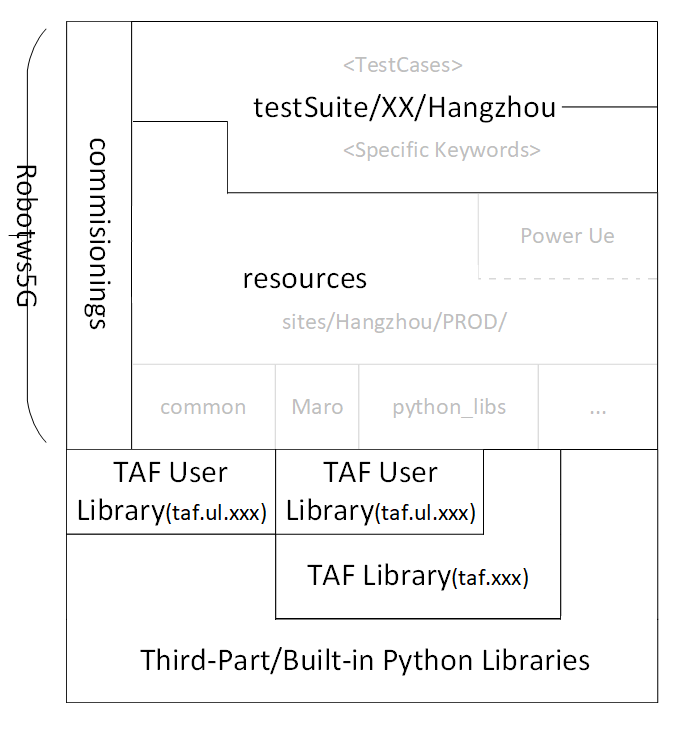

# TAF Introduction

## What Is TAF

TAF is a set of Python libraries maintained and developed by a global forum of programmers from test automation teams. Its goal is to make automated test case development easier and ready for use in the 5G RAN integration and delivery pipeline.

## Robot Framework Support

TAF supports Robot Framework, but it remains independent from Robot Framework itself. This means TAF can also be reused by other test frameworks.

In a Robot Framework based system, TAF acts as the test library layer.

## Compatibility

### Python

TAF supports the following Python versions for legacy environments and compatibility with testing tools inherited from 4G projects:

- Python 2.7.15
- Python 3.6.0

For current 5G test environments, Python 3.6.10 is commonly used.

### Runtime And Hardware Configuration

Supported or related runtime environments include:

- ZTC, in progress
- Cloud Manager, supported by UTE team
- Classic BTS
- Jenkins

### Pipeline

TAF is used in the LTE automated regression pipeline and 5G RAN integration and delivery pipeline.

## System Topology



TAF is used with two main topology types:

- Classical
- Cloudified

### Common Topology Rules

For both Classical and Cloudified topologies:

- Test PC and testline are normally mapped 1:1.
- The Test PC runs the test and hosts the EPC simulator.
- The same concept is used in Cloud Manager.
- If an EPC VM has connectivity with the testline, it can be treated as a Test PC.

### Classical Topology

For QT, Jenkins is recommended for creating and running jobs, but the QT team still needs to decide the final operation model.

When the Jenkins job runs, test cases on the Test PC are invoked.

### Cloudified Topology

For I&V, Cloud Manager is recommended to run test cases through Cloud Manager scripts.

`Agent_5g` usually checks communication between UTE TL (UTE testline) and CM (Cloud Manager). It also prepares and cleans the testline to make sure each test is independent.

## Test Environment Setup On Test VM

### Install Python 3.6.10

Newer Python versions may work, but the current Cloud Manager environment runs on Python 3.6. There is also a lot of LTE tooling that can be reused, so tests should remain compatible with Python 3.6.10 runtime.

The Python environment will be upgraded gradually. Wait for the official update before upgrading the codebase runtime requirement.

If your VM is based on `template-UTE-Debian10`, Python 3.6.10 may already be available. Verify it with:

```bash
python --version
```

Expected output:

```text
Python 3.6.10
```

If Python 3.6.10 is not installed, install it with `pyenv`.

### Install pyenv

Download `pyenv`:

```bash
git clone https://github.com/pyenv/pyenv.git ~/.pyenv
```

If cloning fails with a timeout, configure the required `http_proxy` and `https_proxy` environment variables on the VM before retrying.

Add `pyenv` to the shell environment:

```bash
echo 'export PYENV_ROOT="$HOME/.pyenv"' >> ~/.bash_profile
echo 'export PATH="$PYENV_ROOT/bin:$PATH"' >> ~/.bash_profile
echo -e 'if command -v pyenv 1>/dev/null 2>&1; then\n  eval "$(pyenv init -)"\nfi' >> ~/.bash_profile
```

Restart the shell:

```bash
exec "$SHELL"
```

After relogin or shell restart, install Python 3.6.10:

```bash
pyenv install 3.6.10
```

Example output:

```text
Downloading Python-3.6.10.tar.xz...
-> https://www.python.org/ftp/python/3.6.10/Python-3.6.10.tar.xz
Installing Python-3.6.10...
Installed Python-3.6.10 to /home/ute/.pyenv/versions/3.6.10
```

## Install virtualenv

`virtualenv` copies an existing Python environment to keep the runtime environment for a project isolated from system-level Python changes.

If your VM is based on `template-UTE-Debian8`, `virtualenv` may already be installed. Verify it with:

```bash
which virtualenv
```

Expected example:

```text
/opt/ute/python/bin/virtualenv
```

If `virtualenv` is missing, install it with:

```bash
pip install virtualenv
```

If Python was installed through `pyenv`, `virtualenv` may already be available together with that Python environment.

## Create Python Virtual Environment

### Create From System Python

Use this only when the current system Python version is already Python 3.6.10.

```bash
cd ~/Projects/robotws5g
virtualenv py3
source py3/bin/activate
```

Example output:

```text
New python executable in /home/ute/Projects/robotws5g/py3/bin/python
Please make sure you remove any previous custom paths from your /home/ute/.pydistutils.cfg file.
Installing setuptools, pip, wheel...done.
(py3) ute@ute-image:~/Projects/robotws5g$
```

### Create From pyenv Python

Use this when Python 3.6.10 was installed with `pyenv`.

```bash
cd ~/Projects/robotws5g
virtualenv -p ~/.pyenv/versions/3.6.10/bin/python py3
source py3/bin/activate
```

Example output:

```text
Running virtualenv with interpreter /home/ute/.pyenv/versions/3.6.10/bin/python
New python executable in /home/ute/Projects/robotws5g/py3/bin/python
Installing setuptools, pip, wheel...done.
(py3) ute@ute-image:~/Projects/robotws5g$
```

## Configure pip.conf

Add TAF and UTE repositories to `pip.conf`.

Depending on the pip version, the configuration file may be located at one of these paths:

- `~/.pip/pip.conf`
- `~/.config/pip/pip.conf`

Example configuration:

```ini
[global]
# For Espoo, Finland:
index-url = https://artifactory-espoo2.int.net.nokia.com/artifactory/api/pypi/ute-pypi-virtual/simple

# For Bangalore, India (Artifactory mirror):
#index-url = https://artifactory-blr1.ext.net.nokia.com/artifactory/api/pypi/ta-lib-5g-virtual/simple

# For Hangzhou, China (Artifactory mirror):
#index-url = https://artifactory-hz1.ext.net.nokia.com/artifactory/api/pypi/ta-lib-5g-virtual/simple

extra-index-url = http://pypi.ute.nsn-rdnet.net/
trusted-host = pypi.ute.nsn-rdnet.net artifactory-espoo2.int.net.nokia.com

# Bangalore, India:
#trusted-host = pypi.ute.nsn-rdnet.net artifactory-blr1.ext.net.nokia.com

# Hangzhou, China:
#trusted-host = pypi.ute.nsn-rdnet.net artifactory-hz1.ext.net.nokia.com

[ute_installer]
slave = https://svne1.access.nsn.com/isource/svnroot/
```

For Hangzhou, use the Hangzhou Artifactory address and trusted host.

Verify the active pip configuration with:

```bash
pip config list
```

## Fix /etc/hosts

If you are using a UTE VM, remove the following entries from `/etc/hosts`:

```text
10.45.186.229      files.ute.inside.nsn.com
10.45.186.229      pypi.ute.inside.nsn.com
10.45.186.229      log.ute.inside.nsn.com
```

## Test Project Setup

### Configure Git User

Set the local Git user information before working with the test project.

```bash
git config --global user.name "Your Name"
git config --global user.email "your NOKIA email"
```

Verify the configuration:

```bash
git config --global user.name
git config --global user.email
```

## Test Suite Repository

All test suites for TAF are stored on GitLab. Create a project folder and clone the `robotws5g` repository.

Repository:

```text
https://wrgitlab.int.net.nokia.com/5G/robotws5g.git
```

Clone example:

```bash
mkdir Projects
cd Projects
git clone https://wrgitlab.int.net.nokia.com/5G/robotws5g.git
```

Example output:

```text
Cloning into 'robotws5g'...
Username for 'https://wrgitlab.int.net.nokia.com':
Password for 'https://wrgitlab.int.net.nokia.com':
Warning: Permanently added 'wrgitlab.int.net.nokia.com,10.159.93.91' (RSA) to the list of known hosts.
remote: Counting objects: 17829, done.
remote: Compressing objects: 100% (5691/5691), done.
remote: Total 17829 (delta 12234), reused 17070 (delta 11632)
Receiving objects: 100% (17829/17829), 2.25 MiB | 518.00 KiB/s, done.
Resolving deltas: 100% (12234/12234), done.
Checking connectivity... done.
```

## Install Required Libraries

Activate the virtual environment and install the required packages.

```bash
cd ~/Projects/robotws5g
source py3/bin/activate
pip install ute_installer
pip install -r requirements.cfg
```

## robotws5g Folder Structure

The following is a sample `robotws5g` structure. Test scripts are mainly under `testsuite`.

```text
robotws5g
├─.idea
├─.sanity-checks
│  ├─git
│  ├─python
│  └─robot
├─buildscript
│  └─sw_update
├─resources
│  ├─bb2_files
│  ├─common
│  ├─python_libs
│  ├─Sites
│  │  ├─Wroclaw
│  │  ├─Hangzhou
│  │  └─Ulm
│  └─tm500_scripts_templates
└─testsuite
   ├─OAM
   │  ├─Wroclaw
   │  │  ├─5GI000084
   │  │  ├─5GI000087
   │  │  └─5GI000089
   │  ├─Hangzhou
   │  └─Ulm
   ├─QTPH1
   ├─RRM
   │  └─Ulm
   │     └─99_GetSoftVer
   └─SISO
      ├─Wroclaw
      ├─Hangzhou
      └─Ulm
```

## Related Rules And References

### robotws5g Management

- Robotws5g management rules
- Coding template and MR checklist

### Testline Configuration

- Testline configuration repository
- Official UTE naming convention
- Common testline configuration repository target layout
- Testline configuration repository rules and guidelines
- Gerrit testline configuration operation guides

## Test Case Execution

Activate the virtual environment:

```bash
cd ~/Projects/robotws5g
source py3/bin/activate
```

Run a Robot Framework test case:

```bash
cd ~/Projects/robotws5g/testsuite/QT/Hangzhou
robot -V ./Project/Testline_configuration/7_5_UTE5G402T901/ \
  --pythonpath /home/ute/Projects/robotws5g \
  -L DEBUG \
  -b debug.log \
  -d /home/ute/tmp/ \
  testsuite/SISO/5GC00xxxx/Case.robot
```
