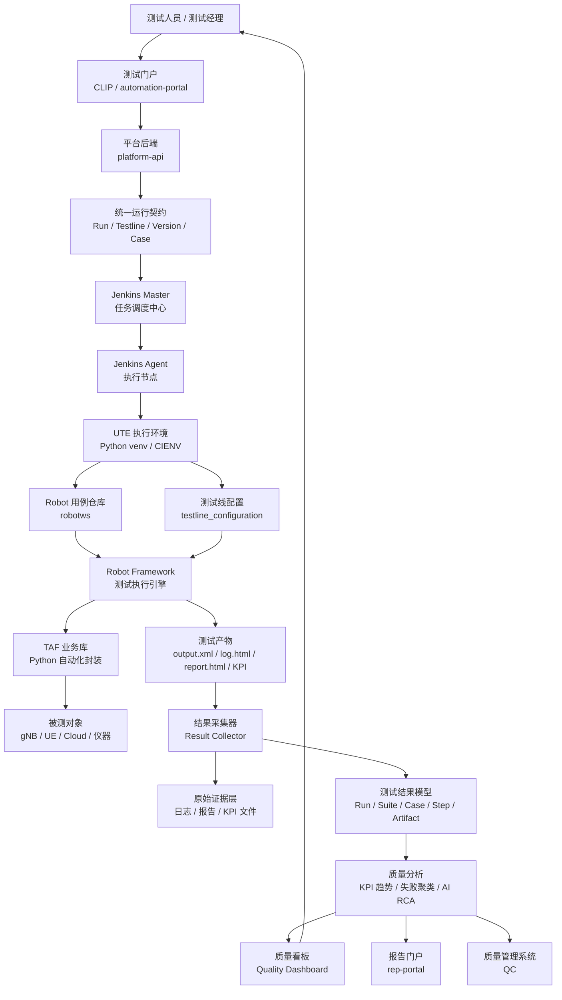

# 软考系统架构师论文写作：基于 5G 自动化测试平台的项目素材

## 1. 项目是否适合写系统架构师论文

`C:\TA\jenkins_robotframework` 项目，以及其中归档的部门现有平台资料 `docs/archive/5g_jenkins_robotframework.md`，非常适合作为软考系统架构师论文素材。

这个项目不建议只描述为“Jenkins + Robot Framework 自动化脚本平台”，而应包装为：

> 面向多测试线的 5G 自动化测试执行与质量分析平台。

它的核心链路可以概括为：

```text
CLIP / automation-portal
  -> platform-api / 平台后端
  -> Jenkins Master
  -> Jenkins Agent / UTE 执行机
  -> robotws + testline_configuration
  -> TAF + Robot Framework
  -> gNB / UE / 仪器等被测对象
  -> rep-portal / QC / KPI / AI 分析
```

项目总体流程图可以整理为：



该项目具备系统架构师论文需要的几个关键特征：

- 有真实业务场景：5G 自动化测试、版本回归、测试线调度、结果归档。
- 有清晰分层架构：门户层、平台 API 层、调度层、执行层、测试库层、结果分析层。
- 有外部系统集成：Jenkins、GitLab、UTE、Robot Framework、TAF、rep-portal、QC。
- 有异步任务闭环：任务提交、执行调度、状态回写、结果上传、报告展示。
- 有可扩展空间：多 agent、多 testline、海量日志、KPI 趋势、失败聚类、AI RCA。

## 2. 最推荐的论文项目定位

最稳的定位是：

> 我参与设计并实现了一套面向 5G 产品研发测试团队的自动化测试执行与质量分析平台。该平台以统一门户作为用户入口，以平台后端作为控制面，以 Jenkins 作为调度引擎，以 UTE 测试线作为执行资源，以 Robot Framework 和 TAF 作为测试执行能力，并通过 rep-portal、QC、KPI 分析和 AI 日志分析形成测试结果闭环。

这个定位比“自动化测试工具”更符合系统架构师论文的要求。

## 3. 最适合套用的论文题目方向

### 3.1 论软件系统的架构设计

这是最推荐、最通用的方向。

可写重点：

- 系统采用分层架构，把用户入口、任务控制、调度执行、测试环境、结果分析分离。
- 平台后端通过统一 run contract 屏蔽不同执行器差异。
- Jenkins 负责调度，UTE 和 testline 负责实际测试执行。
- Robot / TAF 负责对 gNB、UE、仪器等被测对象进行自动化操作。
- rep-portal / QC / KPI / AI analysis 负责结果展示、归档和分析。

### 3.2 论软件架构风格的选择与应用

可写成多种架构风格组合：

- 分层架构：门户层、API 层、调度层、执行层、结果层。
- 管道过滤器：测试执行后依次经过日志收集、报告上传、KPI 生成、异常检测、AI 分析。
- 事件驱动 / 异步回调：Jenkins 执行完成后通过 callback 或上传任务回流结果。
- 主从调度：Jenkins Master 调度多个 Agent / UTE 执行资源。

### 3.3 论软件系统集成架构设计

这个方向非常贴合部门平台。

可写重点：

- CLIP / automation-portal 集成 Jenkins。
- Jenkins 集成 GitLab、UTE、Robot Framework。
- Robot Framework 集成 TAF Python 业务库。
- TAF 集成 gNB、UE、PDU、频谱仪等真实设备。
- 执行结果集成 rep-portal 和 QC。

该题目能突出“异构系统集成、接口契约、边界隔离和数据流转”。

### 3.4 论系统可靠性设计

自动化测试平台天然适合写可靠性。

可写重点：

- Jenkins Agent 离线处理。
- UTE 测试线不可达处理。
- Robot 执行失败与环境失败区分。
- 结果上传失败后的补偿机制。
- callback 幂等。
- artifact manifest 校验。
- run 状态机设计。

推荐状态机示例：

```text
SUBMITTED
  -> QUEUED
  -> RUNNING
  -> RESULT_UPLOADING
  -> ANALYZING
  -> COMPLETED / FAILED / BLOCKED
```

### 3.5 论大数据处理技术在测试质量分析平台中的应用

如果考试题目偏“大数据”或“海量数据处理”，不要硬说原平台就是完整大数据平台，而应写成“在原有自动化执行平台基础上的数据分析架构演进”。

推荐题目包装：

> 论大数据处理技术在 5G 自动化测试质量分析平台中的应用。

核心论点：

> 原有平台已经完成自动化执行和结果归档，但随着 testline、用例、版本和日志规模增长，传统 Jenkins 与 rep-portal 页面无法支撑海量测试结果的统一检索、趋势分析、失败聚类和质量决策。因此在原有执行闭环基础上增加结果采集、统一数据模型、分层存储、实时解析、离线汇总和智能分析能力。

## 4. 部门现有平台为什么符合“多测试线分布式平台”

根据 `5g_jenkins_robotframework.md`，部门平台已有如下特征：

- CLIP 负责用户选择包、testline 和 case。
- Jenkins Master 接受触发请求，并按 label 分配 Agent。
- Jenkins Agent ssh 到 UTE 执行机。
- 每条 testline 有独立 Python venv：`/home/ute/CIENV/<testline>/`。
- `testline_configuration/<TL>` 注入测试线环境模型。
- `robotws` 提供 Robot Framework 用例。
- TAF 封装对 gNB、UE、Cloud、仪器等对象的操作。
- Robot 结果上传到 rep-portal，必要时回写 QC。

因此它已经不是单机脚本系统，而是：

> Jenkins 作为统一调度中心，下挂多个执行环境和多条测试线的分布式自动化测试执行平台。

如果实际生产环境中存在大量 testline、大量 UTE 执行机和大量并发 run，就可以进一步自然包装成“大规模自动化测试执行与结果分析平台”。

## 5. 如何从现有平台改进为“海量测试结果分析平台”

### 5.1 建立统一测试结果数据模型

现有平台结果来源较多：

- Jenkins build result
- Jenkins console log
- Robot `output.xml`
- Robot `log.html` / `report.html`
- `quicktest.xml`
- UTE `debug.log`
- KPI xlsx
- rep-portal 上传记录
- QC 归档状态

建议在论文中抽象出统一模型：

```text
TestRun
  -> TestSuite
  -> TestCase
  -> TestStep / Keyword
  -> Artifact
  -> KPIMetric
  -> FailureReason
  -> Environment / Testline / Version
```

这样可以把散落在 Jenkins、rep-portal、QC、NFS、Artifactory 中的数据转成统一可分析的数据资产。

### 5.2 从“报告上传”升级为“数据采集管道”

原始流程：

```text
Robot 执行
  -> 生成 output.xml / log.html / report.html / xlsx
  -> 上传 rep-portal / QC
  -> 用户查看
```

改进后流程：

```text
Robot 执行
  -> Result Collector
  -> 解析 output.xml / log / KPI
  -> 标准化测试事件
  -> 分层存储
  -> 趋势分析 / 失败聚类 / KPI 异常检测
  -> 质量看板 / 告警 / AI RCA
```

采集器可以完成：

- 解析 Robot `output.xml`，提取 suite、case、keyword、status、elapsed time、error message。
- 解析 Jenkins console log，提取 checkout、环境准备、执行、上传等阶段耗时。
- 解析 KPI xlsx，提取吞吐量、时延、掉线率、成功率等指标。
- 生成标准化 test event，供后续分析。

### 5.3 设计分层存储架构

如果论文题目涉及大数据架构，可以设计如下存储层：

```text
对象存储 / 文件存储：
  保存 output.xml、log.html、report.html、debug.log、xlsx、zip 等原始证据。

关系数据库：
  保存 run、case、testline、version、用户、状态、artifact manifest。

搜索引擎：
  保存 Jenkins log、Robot log、debug log，支持全文检索和失败定位。

分析型数据库：
  保存 KPI、case 结果明细、版本质量趋势、testline 健康度。
```

可以抽象为四层：

```text
原始证据层
  -> 明细数据层
  -> 指标汇总层
  -> 应用服务层
```

### 5.4 增加失败聚类与根因分析

海量测试执行后，人工逐条看日志效率很低。可以增加失败分析能力：

- 按错误信息相似度聚类。
- 按失败 keyword 聚类。
- 按 testline 聚类，识别环境问题。
- 按版本聚类，识别产品回归问题。
- 按 case 历史失败率识别 flaky case。
- 结合规则或 AI 生成 RCA 建议。

示例判断规则：

```text
多个 testline 在同一版本同时出现 attach failure：
  倾向判断为产品版本问题。

只有某一条 testline 高频失败：
  倾向判断为测试环境或设备问题。

同一 case 在多个版本随机失败：
  倾向判断为 flaky 自动化脚本问题。
```

### 5.5 建立质量趋势分析看板

现有平台已有结果展示，但可以升级为质量驾驶舱：

- 每日执行量。
- 通过率、失败率、阻塞率。
- 各 testline 健康度。
- 各版本质量趋势。
- TOP 失败用例。
- TOP 失败模块。
- KPI 趋势。
- flaky case 榜单。
- 长耗时 case 榜单。
- 环境稳定性排名。

这样平台从“执行与结果归档系统”升级为“质量决策系统”。

### 5.6 引入实时链路和离线链路

如果写海量数据处理，可以设计两条链路：

```text
实时链路：
  run 完成后立即解析结果，刷新 run detail、失败原因和告警。

离线链路：
  每天定时汇总历史结果，生成质量趋势、失败聚类和版本对比。
```

实时链路解决“刚跑完怎么看结果”，离线链路解决“长期质量趋势和历史规律挖掘”。

### 5.7 强化可靠性和补偿机制

海量结果回流时容易出现：

- Jenkins 已完成，但 rep-portal 上传失败。
- Robot 执行完成，但部分 artifact 缺失。
- QC 回写失败。
- 网络中断导致重复上传。
- 同一个 run 被重复回调。
- KPI 解析失败。

建议设计：

- 全局唯一 `run_id`。
- callback 幂等。
- artifact manifest 校验。
- 结果解析重试队列。
- 上传失败补偿任务。
- 状态机记录执行阶段。
- 异常 run 可人工重放。

部门平台中已有“RP 上传失败后由 `PostResult2RP` 扫 Mongo 重发”的机制，这可以在论文中扩展为“补偿事务和最终一致性设计”。

## 6. 推荐论文主线：两代架构演进

论文可以采用“两代架构演进”的叙述方式。

第一代：执行驱动型平台。

```text
CLIP
  -> Jenkins
  -> UTE
  -> Robot / TAF
  -> rep-portal / QC
```

它解决的问题：

- 测试任务自动触发。
- 多 testline 调度。
- Robot 用例执行。
- 测试结果上传。
- QC 归档。

第二代：数据驱动型质量分析平台。

```text
CLIP / automation-portal
  -> platform-api
  -> Jenkins / Agent / UTE
  -> Robot / TAF
  -> Result Collector
  -> Data Lake / Result Warehouse
  -> KPI Analysis / Failure Clustering / AI RCA
  -> Quality Dashboard / rep-portal / QC
```

它进一步解决：

- 海量测试结果统一建模。
- 日志和 artifact 分层存储。
- 测试质量趋势分析。
- 失败聚类和根因定位。
- KPI 异常检测。
- 版本准入决策支持。

## 7. 可直接用于论文的摘要模板

可以改写为：

> 我所在项目组承担了某 5G 产品自动化测试平台的架构设计与演进工作。该平台面向多个测试团队和多条测试线，支持测试经理通过统一门户选择软件包、测试线和测试用例，系统自动调度 Jenkins Pipeline，在对应 UTE 测试环境中执行 Robot Framework 和 TAF 自动化用例，并将执行结果、日志、报告、KPI 指标回传到结果门户和质量管理系统。随着测试线数量和日执行任务量不断增加，原有以 Jenkins 构建页面和结果门户为中心的方式难以支撑海量测试结果的统一分析。为此，我们在原有执行闭环基础上设计了结果采集、统一数据模型、分层存储、实时解析、离线汇总、失败聚类和 KPI 趋势分析能力，将系统从自动化执行平台演进为质量分析平台。

## 8. 写作时需要注意的边界

- 不要暴露真实公司域名、IP、账号、内部仓库名和客户信息。
- 可以把 CLIP、rep-portal、QC 等写成“测试门户、报告门户、质量管理系统”。
- 可以把 gNB、UE 等写成“5G 基站设备、终端模拟器和测试仪表”。
- 不要夸大为“纯大数据平台”，更稳的说法是“面向海量测试结果的质量分析平台”。
- 如果题目不是大数据方向，优先写架构设计、系统集成、可靠性或可扩展性。

## 9. 最推荐准备的母稿题目

建议优先准备：

> 论面向多测试线的自动化测试与质量分析平台架构设计。

这篇母稿可以根据考试题目灵活改写：

- 遇到“架构设计”：强调分层、解耦、接口契约、执行闭环。
- 遇到“系统集成”：强调 Jenkins、UTE、Robot、TAF、rep-portal、QC 的集成。
- 遇到“可靠性”：强调状态机、幂等、重试、补偿、artifact 校验。
- 遇到“可扩展性”：强调多 agent、多 testline、执行器扩展、分析能力扩展。
- 遇到“大数据”：强调结果采集、统一模型、分层存储、实时与离线分析。

## 10. 论文范文：论面向海量测试结果的自动化测试质量分析平台架构设计

### 摘要

我所在项目组承担了某 5G 产品自动化测试平台的架构设计与演进工作。该平台面向研发测试、版本回归和质量准入场景，支持测试人员通过统一门户选择软件包、测试线和测试用例，由平台后端生成测试运行任务，再调度 Jenkins、执行机、Robot Framework 和测试业务库完成自动化测试，并将测试日志、执行报告、KPI 指标和质量结论回传到结果门户和质量管理系统。随着测试线数量、自动化用例数量和日常回归频次持续增加，原有以 Jenkins 构建页面和报告门户为中心的方式，逐渐难以支撑海量测试结果的统一检索、趋势分析、失败聚类和版本质量决策。针对这些问题，我参与设计了面向海量测试结果的质量分析平台架构，通过统一运行契约、分层架构、异步调度、结果采集、分层存储、实时解析与离线汇总等设计，将系统从“自动化执行平台”演进为“自动化测试与质量分析平台”。本文结合项目实践，论述该系统的架构设计过程、关键技术方案以及实施效果。

### 正文

该项目的业务背景来源于 5G 产品研发测试过程。一个软件版本发布前，通常需要在多条测试线上执行大量自动化用例，测试对象包括基站设备、终端模拟器、云化网元和测试仪表等。原有平台已经能够通过测试门户触发 Jenkins Pipeline，在对应执行环境中拉取测试用例仓库和测试线配置仓库，启动 Robot Framework 调用测试业务库完成自动化测试，并把报告上传到结果门户和质量管理系统。这个流程解决了自动化执行问题，但随着测试规模扩大，新的问题逐渐显现：第一，测试结果分散在 Jenkins、文件系统、报告门户和质量系统中，缺少统一数据模型；第二，单次执行会产生 output.xml、log.html、report.html、debug.log、KPI 表格等多类产物，人工排查成本较高；第三，多条测试线并发执行时，测试环境问题、产品缺陷和自动化脚本问题难以快速区分；第四，管理者不仅关注某次执行是否通过，还需要关注版本质量趋势、失败聚类、测试线健康度和 KPI 异常。因此，我们决定在原有执行闭环基础上，设计一个面向海量测试结果的质量分析平台。

在总体架构上，我将系统划分为门户层、平台服务层、调度执行层、结果采集层、数据存储层和分析展示层。门户层为测试人员提供任务提交、运行列表、结果详情和质量看板。平台服务层负责用户请求校验、运行任务建模、状态流转和接口聚合。调度执行层以 Jenkins Master 为调度中心，根据测试线、标签和资源状态选择合适的 Agent 或执行机，并在对应测试环境中执行 Robot Framework 和测试业务库。结果采集层负责从 Jenkins、Robot 报告、调试日志和 KPI 文件中提取结构化数据。数据存储层采用分层设计，既保存原始证据，又保存可检索、可统计、可分析的明细数据。分析展示层面向测试人员和管理者，提供失败原因聚类、KPI 趋势、版本质量对比和测试线健康度等能力。

为了降低不同执行类型之间的耦合，我在平台服务层设计了统一运行契约。测试任务被抽象为 Run，核心字段包括运行编号、软件版本、测试线、用例集合、执行器类型、环境参数和回调地址。对于 Robot 执行、KPI 后处理、AI 日志分析等差异化能力，采用扩展字段和插件化处理方式承载。这样门户层不需要直接理解 Jenkins Job 参数，Jenkins 也不需要感知上层业务页面的变化。平台后端负责把统一 Run 契约转换为 Jenkins 可执行的参数，并在任务执行过程中维护状态机。典型状态包括已提交、排队中、执行中、结果上传中、分析中、完成、失败和阻塞。状态机的设计使得用户能够清楚看到任务处于哪个阶段，也便于系统在异常情况下进行补偿处理。

在调度执行层，我们延续了 Jenkins Master 和多 Agent 的模式，但对资源路由进行了规范化设计。每条测试线被视为一种受控测试资源，具有标签、执行机地址、Python 虚拟环境、设备拓扑和可用状态等属性。用户提交任务时选择测试线或测试线组，平台根据资源配置生成调度参数，由 Jenkins 分配合适的 Agent，再通过脚本进入指定执行环境，拉取测试用例和测试线配置，最后启动 Robot Framework。这样的设计使系统能够从单条测试线扩展到多条测试线并发执行。同时，为避免同一测试线被重复占用，平台对测试线资源增加了预约和释放机制；当执行机不可达、环境准备失败或用例执行超时时，系统会记录明确失败阶段，并把任务转入可重试或人工处理状态。

结果采集层是本次架构演进的重点。原来系统更多关注报告上传，即执行完成后把 Robot 报告和日志上传到结果门户。改进后，我们增加了结果采集器，将报告上传升级为数据采集管道。采集器解析 Robot output.xml，提取测试套、测试用例、关键字、执行状态、耗时和错误信息；解析 Jenkins 日志，提取代码拉取、环境准备、用例执行、报告上传等阶段耗时；解析 KPI 文件，提取吞吐量、时延、成功率、掉线率等关键指标；同时生成 artifact manifest，记录每个报告文件的类型、路径、大小、校验值和上传状态。通过这一设计，系统不再只保存“一个可点击的报告链接”，而是能够把每次执行转化为可检索、可聚合和可分析的数据。

在数据存储方面，我采用分层存储思想。原始证据层保存 output.xml、log.html、report.html、debug.log、KPI 表格和压缩包等文件，保证问题追溯时能看到完整上下文；业务明细层保存 Run、测试线、版本、用例、步骤、状态和 artifact manifest 等结构化信息；日志检索层保存 Jenkins 日志和 Robot 关键日志，支持按错误关键字、用例名和测试线快速检索；指标分析层保存用例结果、KPI 指标和版本质量汇总，支撑趋势分析和报表展示。通过分层存储，系统既避免了把所有数据都塞进关系数据库造成性能和维护问题，也避免了只保留文件而无法做统计分析的问题。

为了支撑海量测试结果分析，我们在分析层设计了实时和离线两条链路。实时链路在单次 Run 完成后立即解析结果，刷新运行详情、失败摘要和 KPI 结论，使测试人员可以快速判断本次失败属于产品问题、环境问题还是脚本问题。离线链路每天定时汇总历史数据，生成版本通过率趋势、模块失败排名、测试线健康度、长耗时用例、flaky case 榜单和 KPI 异常趋势。对于失败聚类，我们综合错误消息、失败关键字、测试线、软件版本和历史失败记录进行判断。例如，同一版本在多条测试线同时出现类似连接失败，更可能是产品版本或公共依赖问题；如果只有某一条测试线频繁失败，则更可能是环境或设备问题；如果同一用例在多个版本中随机失败，则可能是自动化脚本稳定性问题。该设计显著降低了人工逐条查看日志的成本。

可靠性方面，我重点考虑了异步任务和结果回流的异常场景。由于 Jenkins 执行、Robot 测试、报告上传和结果分析不是一个同步事务，任何环节都可能失败，因此系统采用最终一致性的处理方式。每个 Run 都有全局唯一编号，回调和结果上传接口按 Run 编号实现幂等处理；artifact manifest 用于判断产物是否完整；结果解析失败会进入重试队列；报告门户或质量系统暂时不可用时，系统记录上传失败状态并通过补偿任务重新上传；对于重复回调和重复上传，系统只更新缺失字段或保持已有成功结果。通过状态机、幂等接口、重试队列和补偿机制，平台在面对网络波动、执行机异常和外部系统不可用时仍能保持结果可追踪。

安全和可维护性方面，我们将用户入口和 Jenkins 执行入口隔离。普通测试用户只访问统一门户和平台 API，不直接接触 Jenkins 凭据和底层执行脚本。平台后端负责参数校验、权限控制和任务转换，避免用户提交非法测试线、错误版本或危险参数。系统文档也按模块组织，分别记录门户、平台 API、执行层、结果采集和分析层的接口契约与运维说明。对于后续扩展，我们预留了多执行器类型和分析插件接口，使平台能够继续接入新的测试框架、KPI 检测器和 AI 根因分析能力。

项目实施后，平台从以 Jenkins 构建记录为中心的自动化执行系统，逐步演进为以 Run 为核心对象的质量分析系统。测试人员可以在统一页面查看任务状态、失败摘要、报告链接和 KPI 结论；测试负责人可以按版本、测试线和模块查看通过率趋势和重点失败原因；平台维护人员可以根据执行阶段和 artifact manifest 快速定位是调度失败、环境失败、用例失败还是上传失败。该架构提高了测试结果分析效率，增强了系统可扩展性和可靠性，也为后续引入 AI 日志摘要、自动 RCA 和质量准入规则打下了基础。

综上，在本项目中，我围绕 5G 自动化测试规模扩大带来的结果分散、分析困难和排障效率低等问题，设计了面向海量测试结果的自动化测试质量分析平台架构。该架构通过分层解耦、统一运行契约、多测试线调度、结果采集管道、分层存储、实时与离线分析、幂等与补偿机制等设计，实现了从自动化执行到质量分析的演进。实践表明，该方案既保留了 Jenkins、Robot Framework 和测试业务库的成熟执行能力，又提升了平台在海量测试结果场景下的可维护性、可扩展性和质量决策能力。
