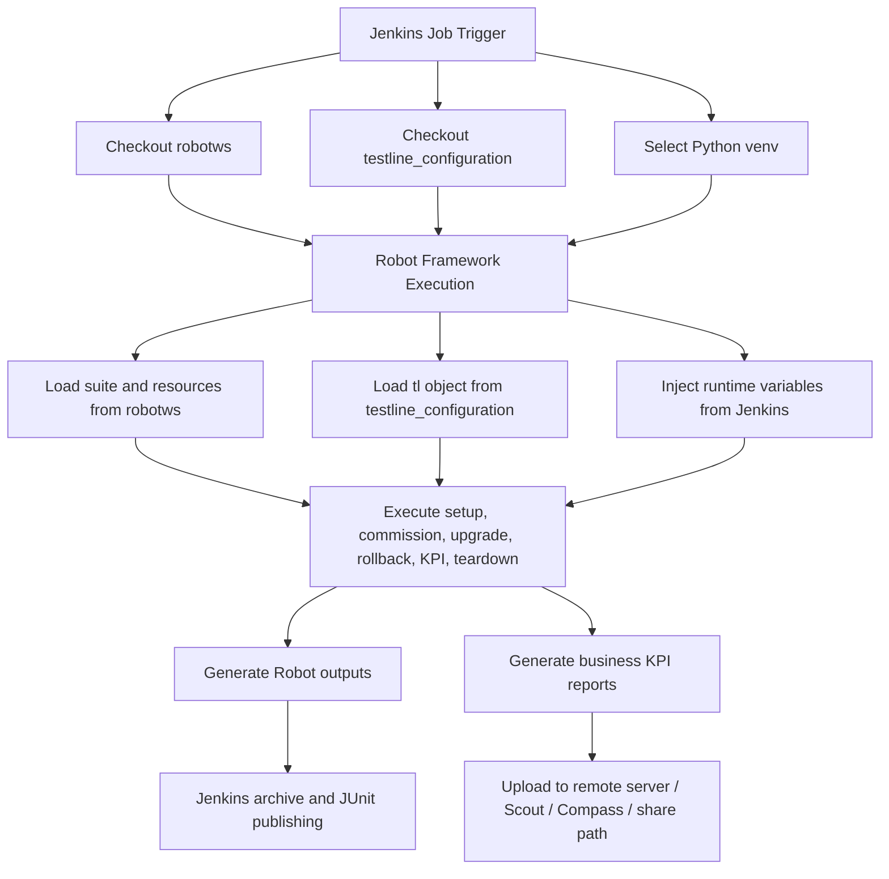

# robotws + testline_configuration + Jenkins Automation Platform Guide

## 1. Document Scope

This document consolidates the following content into one place:

- Framework analysis of `robotws` and `testline_configuration`
- How Jenkins integrates with the two repositories to run Robot Framework cases
- Technical points and execution flow of the current automation platform
- Requirement tiers for rebuilding the platform on a new Debian server
- Detailed deployment SOP for Debian
- Jenkins Pipeline template
- Jenkins Shared Library template
- Plugin, credential, and lock resource checklists
- Bootstrap script template for initial server setup

The analysis is based on the current workspace content and the real Robot execution command provided by the user.

## 2. Repository Roles and Overall Architecture

### 2.1 `robotws` role

`robotws` is the test execution repository.

It mainly contains:

- Robot Framework test suites under `testsuite/`
- Shared Robot resources and reusable keywords
- Python libraries imported by Robot
- Report generation logic, including business Excel reports
- Environment preparation, cleanup, rollback, KPI collection, and upload logic

From the repository structure and README, `robotws` is not only a pure test case repository. It is the main orchestration layer for the full test execution lifecycle.

Typical responsibilities in `robotws`:

- Define test suites and test cases
- Import common resources and libraries
- Connect to gNB/eNB/test PC and external systems
- Execute commissioning, upgrade, rollback, setup, teardown
- Collect logs and KPI data
- Generate Robot standard output and business reports
- Upload reports to remote share paths or KPI platforms

### 2.2 `testline_configuration` role

`testline_configuration` is the environment model repository.

It mainly contains:

- One directory per test line
- A Python `__init__.py` in each test line directory
- Test line topology, device models, connection details, ports, radios, test PC, PDU, RU, etc.

This repository is not a static configuration repository only. It is a Python-based runtime model repository.

Each test line typically exports:

```python
tl = TestLine(...)
__all__ = ["tl"]
```

This means Robot can load the test line as a Python variable file and access the environment through `${tl}`.

### 2.3 Jenkins role

Jenkins is the scheduling and CI orchestration layer.

It mainly does the following:

- Receives manual or triggered job requests
- Checks out `robotws` and `testline_configuration`
- Selects Python runtime environment
- Builds the Robot execution command dynamically
- Injects build, branch, test line, and runtime variables
- Runs a single suite or a single test case
- Collects Robot XML and artifacts
- Displays PASS/FAIL and archives outputs

The core business logic is not in Jenkins itself. It is mostly implemented in `robotws` resources and Python libraries.

## 3. Current Platform Architecture

### 3.1 Layered view

The current automation platform can be described in four layers:

1. Scheduling layer: Jenkins
2. Execution framework layer: Robot Framework + Python runtime
3. Business orchestration layer: `robotws`
4. Environment model layer: `testline_configuration`

### 3.2 Logical data flow



## 4. Real Jenkins Command and What It Means

### 4.1 Provided execution command

```bash
/home/ute/CIENV/7_5_UTE5G402T813/bin/activate
http_proxy= https_proxy= python -m robot \
 --pythonpath /opt/transformers.dynamic.nsn-net.net/workspace/CRT/Master/WebTrigger/Manual_VRF_HAZ_T06@10/4443/7_5_UTE5G402T813/robotws \
 -v AF_PATH:http://10.101.54.7/SBTS00/SBTS00_ENB_9999_260410_000010/SBTS00_ENB_9999_260410_000010_release_BTSSM_downloadable_A54.zip \
 -v target_version:SBTS00_ENB_9999_260412_000003 \
 -v testline_name:7_5_UTE5G402T813 \
 -v fdswOld:LN_WN_FDSW18A_0000_100164_000000 \
 -v fdswNew:LN_WN_FDSW19_0000_000154_000000 \
 -v uploadQC:false \
 -v caseBranch:stella_tmo_0323 \
 -x quicktest.xml \
 -b debug.log \
 -d artifact/quicktest/retry-0/TMO_E2E_Reproduction_CRT/ \
 -V testline_configuration/7_5_UTE5G402T813 \
 -L TRACE \
 -t 05437018_EDA_UL_bler_verify_after_scell_released \
 robotws/testsuite/Hangzhou/RRM/RAN_PZ_HAZ_34/None_Feature_SG6/TMO_E2E_Reproduction_CRT.robot
```

### 4.2 Command breakdown

#### Step 1: activate dedicated Python environment

```bash
/home/ute/CIENV/7_5_UTE5G402T813/bin/activate
```

This indicates that the execution environment is isolated, and often one test line or one environment family has a dedicated virtual environment.

#### Step 2: clear proxy variables

```bash
http_proxy= https_proxy=
```

This prevents proxy settings from interfering with internal device, package, or service access.

#### Step 3: use Robot Framework as Python module

```bash
python -m robot
```

The execution entry is standard Robot Framework. Jenkins is not doing custom execution logic here.

#### Step 4: add `robotws` to Python path

```bash
--pythonpath .../robotws
```

This allows Robot and Python to resolve modules, resources, and libraries inside `robotws`.

#### Step 5: inject runtime variables

Examples:

- `AF_PATH`: build package URL
- `target_version`: version expected after upgrade
- `testline_name`: logical test line name
- `fdswOld`, `fdswNew`: related software versions
- `uploadQC`: whether to upload QC
- `caseBranch`: branch marker used by business logic

These variables are used by test resources and keywords to alter behavior dynamically.

#### Step 6: load test line variable file

```bash
-V testline_configuration/7_5_UTE5G402T813
```

This is the key link between Jenkins and the environment repository.

Robot loads the Python variable file from the selected test line directory. That file exports `${tl}` as a structured environment object.

#### Step 7: run only one test case

```bash
-t 05437018_EDA_UL_bler_verify_after_scell_released
```

This means Jenkins is targeting a single test case inside a larger suite.

#### Step 8: generate standard outputs

```bash
-x quicktest.xml
-b debug.log
-d artifact/...
-L TRACE
```

This creates:

- xUnit-compatible XML for Jenkins result publishing
- debug log for troubleshooting
- artifact directory for Robot outputs and generated files
- trace-level logs for detailed failure analysis

## 5. How `robotws` and `testline_configuration` Work Together

### 5.1 Environment injection model

The integration pattern is:

1. Jenkins chooses a test line
2. Robot loads the corresponding variable file from `testline_configuration`
3. The test line file constructs `tl = TestLine(...)`
4. Robot resources and libraries use `${tl}` to access devices and topology
5. The same case can run on different test lines with different environment objects

This design cleanly separates test logic from environment topology.

### 5.2 Why this design is important

Benefits:

- Test cases do not hardcode device IPs and topology
- Different test lines can reuse the same Robot suites
- Environment differences are localized in one repository
- TAF/UTE libraries can consume structured objects instead of raw strings

Tradeoffs:

- Strong dependency on Python runtime and internal libraries
- More complex debugging than plain YAML/JSON configuration
- Test execution depends on successful import of Python model objects

## 6. Case-Level Execution Logic Example

Using the suite:

`robotws/testsuite/Hangzhou/RRM/RAN_PZ_HAZ_34/None_Feature_SG6/TMO_E2E_Reproduction_CRT.robot`

Observed pattern:

- The suite imports multiple common resources
- Test cases rely heavily on common keywords
- Suite setup and teardown are delegated to shared TMO resource files
- Test cases mainly define business flow
- Setup/commission, rollback, KPI report generation, and upload are done by common resources

Typical flow of a business case:

1. Common setup
2. gNB precondition check
3. Optional rollback check
4. Commissioning and readiness validation
5. UE preparation
6. Test action execution
7. KPI or throughput collection
8. Report generation
9. Upload to shared location or KPI platform
10. Common teardown and environment recovery

## 7. Core Technical Points

### 7.1 Robot + Python variable file integration

The platform uses Python modules as Robot variable files. This is more powerful than static files and allows a full environment object graph.

### 7.2 Clear separation of test logic and environment logic

- `robotws`: test workflows and reusable business logic
- `testline_configuration`: environment description and topology model
- Jenkins: runtime selection and scheduling

### 7.3 Heavy dependence on internal TAF and UTE ecosystem

This platform relies on many internal packages such as:

- `taf.*`
- `ute_*`
- Robot libraries used by internal frameworks

Without access to the internal package source or offline wheels, the real platform cannot be rebuilt successfully.

### 7.4 Business reporting is part of the framework

This is not only about `output.xml`, `log.html`, and `report.html`. The platform also generates business Excel KPI reports and uploads them to remote storage.

### 7.5 Environment cleanup is part of platform stability

The repository already contains cleanup logic for:

- old build packages
- old workspace directories
- syslog files
- downloads
- Jenkins-triggered workspaces

This indicates long-term platform stability depends on strong cleanup and storage management.

## 8. Requirement Tiers for Rebuilding on Debian

### 8.1 P0: Minimum runnable platform

Goal: run one Robot case from Jenkins and collect PASS or FAIL.

Required:

- Debian server
- Jenkins installed
- Git access to both repositories
- Python runtime
- virtual environment
- Robot Framework
- ability to run one suite or one test case
- `quicktest.xml` collection in Jenkins

### 8.2 P1: Stable and usable platform

Goal: daily usage with controllable failures and traceable outputs.

Required:

- Credentials management
- Test line resource locking
- Artifact retention
- Workspace cleanup
- JUnit publishing
- Parameter validation
- Dry-run capability
- Timeout control
- Reproducible Python dependencies

### 8.3 P2: Full production-like platform

Goal: approximate current production capability.

Required:

- access to private Python package repository
- full TAF and UTE dependency installation
- share path upload
- Scout and Compass integration
- build package download chain
- multiple test line scheduling
- rollback and recovery behavior
- KPI report chain

### 8.4 P3: Enterprise-grade platform

Goal: scalable, maintainable, auditable automation platform.

Required:

- Jenkins Configuration as Code
- role-based access control
- node pools and labels
- test line reservation system
- monitoring and alerting
- audit trail
- job DSL or shared library
- change management for platform configs

## 9. Debian Deployment SOP

### 9.1 Step 1: prepare network and system baseline

Check the following before anything else:

- fixed IP address
- DNS resolution
- NTP time sync
- SSH connectivity
- access to Git repositories
- access to internal Python package source
- access to test line device network
- access to Scout, Compass, share path, and build file servers

Recommended commands:

```bash
ping -c 3 git.example.local
ping -c 3 fileserver.example.local
nslookup git.example.local
curl -I https://your-artifactory.example
```

### 9.2 Step 2: install base packages

```bash
sudo apt update
sudo apt install -y \
  git curl wget vim unzip zip rsync jq \
  python3 python3-venv python3-pip python3-dev \
  build-essential libssl-dev libffi-dev \
  openjdk-17-jre-headless \
  smbclient cifs-utils \
  net-tools iputils-ping dnsutils
```

If required by dependencies:

```bash
sudo apt install -y libxml2-dev libxslt1-dev zlib1g-dev
```

### 9.3 Step 3: create execution users and directories

```bash
sudo useradd -m -s /bin/bash ute
sudo mkdir -p /opt/ci/{venvs,workspaces,artifacts,logs,repos}
sudo chown -R ute:ute /opt/ci
```

If Jenkins must access the same directory tree:

```bash
sudo usermod -aG ute jenkins
sudo chmod -R 775 /opt/ci
```

### 9.4 Step 4: install Jenkins

Install Jenkins and start it as a systemd service.

Recommended surrounding components:

- Jenkins LTS
- Nginx reverse proxy
- HTTPS certificate

Recommended Jenkins plugins:

- Pipeline
- Git
- Credentials Binding
- SSH Agent
- JUnit
- HTML Publisher
- Workspace Cleanup
- Lockable Resources
- Timestamper
- AnsiColor
- Role-based Authorization
- Configuration as Code

### 9.5 Step 5: create Python runtime

Example:

```bash
sudo -u ute python3 -m venv /opt/ci/venvs/robotws-py310
sudo -u ute /opt/ci/venvs/robotws-py310/bin/python -m pip install -U pip setuptools wheel
```

### 9.6 Step 6: configure private pip source

Example:

```bash
sudo -u ute mkdir -p /home/ute/.pip
cat >/home/ute/.pip/pip.conf <<'EOF'
[global]
index-url = https://your-artifactory.example/api/pypi/pypi/simple
trusted-host = your-artifactory.example
timeout = 120
EOF
sudo chown -R ute:ute /home/ute/.pip
```

### 9.7 Step 7: clone repositories

```bash
sudo -u ute git clone <robotws_repo_url> /opt/ci/repos/robotws
sudo -u ute git clone <testline_configuration_repo_url> /opt/ci/repos/testline_configuration
```

### 9.8 Step 8: install dependencies

```bash
sudo -u ute /opt/ci/venvs/robotws-py310/bin/pip install robotframework
sudo -u ute /opt/ci/venvs/robotws-py310/bin/pip install -r /opt/ci/repos/robotws/requirements.cfg
```

Risk point:

The platform depends heavily on internal packages. If private package access is unavailable, installation will fail.

### 9.9 Step 9: verify dry run locally

```bash
sudo -u ute bash -lc '
source /opt/ci/venvs/robotws-py310/bin/activate
python -m robot \
  --dryrun \
  --pythonpath /opt/ci/repos/robotws \
  -V /opt/ci/repos/testline_configuration/1_2_UTE4GCLOUD022 \
  -L TRACE \
  /opt/ci/repos/robotws/testsuite/Hangzhou/RRM/RAN_PZ_HAZ_34/None_Feature_SG6/TMO_E2E_Reproduction_CRT.robot
'
```

### 9.10 Step 10: verify real run with parameters

```bash
sudo -u ute bash -lc '
source /opt/ci/venvs/robotws-py310/bin/activate
export http_proxy=
export https_proxy=
mkdir -p /opt/ci/artifacts/test-run-001

python -m robot \
  --pythonpath /opt/ci/repos/robotws \
  -v AF_PATH:"http://10.101.54.7/SBTS00/SBTS00_ENB_9999_260410_000010/SBTS00_ENB_9999_260410_000010_release_BTSSM_downloadable_A54.zip" \
  -v target_version:"SBTS00_ENB_9999_260412_000003" \
  -v testline_name:"7_5_UTE5G402T813" \
  -v fdswOld:"LN_WN_FDSW18A_0000_100164_000000" \
  -v fdswNew:"LN_WN_FDSW19_0000_000154_000000" \
  -v uploadQC:"false" \
  -v caseBranch:"stella_tmo_0323" \
  -x /opt/ci/artifacts/test-run-001/quicktest.xml \
  -b /opt/ci/artifacts/test-run-001/debug.log \
  -d /opt/ci/artifacts/test-run-001 \
  -V /opt/ci/repos/testline_configuration/7_5_UTE5G402T813 \
  -L TRACE \
  -t "05437018_EDA_UL_bler_verify_after_scell_released" \
  /opt/ci/repos/robotws/testsuite/Hangzhou/RRM/RAN_PZ_HAZ_34/None_Feature_SG6/TMO_E2E_Reproduction_CRT.robot
'
```

### 9.11 Step 11: configure Jenkins credentials

Recommended credential groups:

- Git SSH key
- Private PyPI or Artifactory credentials
- Samba or file share credentials
- Device access credentials
- Scout or Compass API credentials if needed

### 9.12 Step 12: create test line locks

Use Jenkins `Lockable Resources` plugin.

Recommended model:

- one resource per test line
- resource name exactly equals `TESTLINE_NAME`

Example resources:

- `7_5_UTE5G402T813`
- `7_5_UTE5G402T816`
- `7_5_UTE5G402T080`

### 9.13 Step 13: archive and retain outputs

Always archive at least:

- `quicktest.xml`
- `debug.log`
- `artifact/**`

If KPI Excel or business reports are generated, archive those too.

### 9.14 Step 14: cleanup policy

Add both repository-level and platform-level cleanup:

- Workspace cleanup after build
- Keep only latest N builds
- Regular cleanup of old artifacts
- Disk usage alerting
- Optional venv rebuild or validation cadence

## 10. Jenkins Pipeline Template

This template is aligned with the current execution style.

```groovy
pipeline {
    agent { label 'robot-debian' }

    options {
        timestamps()
        ansiColor('xterm')
        disableConcurrentBuilds()
        buildDiscarder(logRotator(numToKeepStr: '30', artifactNumToKeepStr: '30'))
        timeout(time: 8, unit: 'HOURS')
    }

    parameters {
        string(name: 'ROBOTWS_BRANCH', defaultValue: 'master', description: 'robotws branch')
        string(name: 'TLCONF_BRANCH', defaultValue: 'master', description: 'testline_configuration branch')
        string(name: 'TESTLINE_NAME', defaultValue: '7_5_UTE5G402T813', description: 'testline name')
        string(name: 'SUITE_PATH', defaultValue: 'robotws/testsuite/Hangzhou/RRM/RAN_PZ_HAZ_34/None_Feature_SG6/TMO_E2E_Reproduction_CRT.robot', description: 'suite path in workspace')
        string(name: 'TEST_NAME', defaultValue: '05437018_EDA_UL_bler_verify_after_scell_released', description: 'robot test case name')
        string(name: 'AF_PATH', defaultValue: '', description: 'build package URL')
        string(name: 'TARGET_VERSION', defaultValue: '', description: 'target version')
        string(name: 'FDSW_OLD', defaultValue: '', description: 'fdsw old version')
        string(name: 'FDSW_NEW', defaultValue: '', description: 'fdsw new version')
        string(name: 'CASE_BRANCH', defaultValue: 'stella_tmo_0323', description: 'case branch marker')
        choice(name: 'UPLOAD_QC', choices: ['false', 'true'], description: 'upload QC')
        choice(name: 'LOG_LEVEL', choices: ['TRACE', 'DEBUG', 'INFO'], description: 'robot log level')
        string(name: 'PYTHON_ENV_PATH', defaultValue: '/opt/ci/venvs/7_5_UTE5G402T813', description: 'python virtualenv path')
        booleanParam(name: 'DRY_RUN', defaultValue: false, description: 'run robot in dry-run mode')
    }

    environment {
        ROBOTWS_REPO = 'ssh://git@example.com/path/robotws.git'
        TLCONF_REPO = 'ssh://git@example.com/path/testline_configuration.git'
        ARTIFACT_DIR = "artifact/quicktest/retry-0/${JOB_BASE_NAME}/${BUILD_NUMBER}"
        ROBOT_XUNIT = 'quicktest.xml'
        ROBOT_DEBUG = 'debug.log'
    }

    stages {
        stage('Clean Workspace') {
            steps {
                cleanWs()
            }
        }

        stage('Checkout Repos') {
            steps {
                dir('robotws') {
                    git branch: params.ROBOTWS_BRANCH, credentialsId: 'git-ssh-key', url: env.ROBOTWS_REPO
                }
                dir('testline_configuration') {
                    git branch: params.TLCONF_BRANCH, credentialsId: 'git-ssh-key', url: env.TLCONF_REPO
                }
            }
        }

        stage('Validate Inputs') {
            steps {
                script {
                    if (!params.TESTLINE_NAME?.trim()) {
                        error('TESTLINE_NAME is required')
                    }
                    if (!params.SUITE_PATH?.trim()) {
                        error('SUITE_PATH is required')
                    }
                    if (!params.TEST_NAME?.trim()) {
                        error('TEST_NAME is required')
                    }
                    if (!fileExists("testline_configuration/${params.TESTLINE_NAME}/__init__.py")) {
                        error("Missing testline config: testline_configuration/${params.TESTLINE_NAME}/__init__.py")
                    }
                    if (!fileExists(params.SUITE_PATH)) {
                        error("Missing suite file: ${params.SUITE_PATH}")
                    }
                }
            }
        }

        stage('Prepare Runtime') {
            steps {
                sh '''
                    set -eu
                    test -f "${PYTHON_ENV_PATH}/bin/activate"
                    . "${PYTHON_ENV_PATH}/bin/activate"
                    python --version
                    python -m robot --version
                '''
            }
        }

        stage('Lock Testline And Run') {
            steps {
                lock(resource: params.TESTLINE_NAME) {
                    withCredentials([
                        usernamePassword(credentialsId: 'samba-credentials', usernameVariable: 'SAMBA_USER', passwordVariable: 'SAMBA_PASS')
                    ]) {
                        sh """
                            set -eu
                            . "${params.PYTHON_ENV_PATH}/bin/activate"
                            export http_proxy=
                            export https_proxy=
                            mkdir -p "${env.ARTIFACT_DIR}"

                            DRYRUN_OPT=""
                            if [ "${params.DRY_RUN}" = "true" ]; then
                              DRYRUN_OPT="--dryrun"
                            fi

                            python -m robot \
                              $DRYRUN_OPT \
                              --pythonpath "${WORKSPACE}/robotws" \
                              -v AF_PATH:"${params.AF_PATH}" \
                              -v target_version:"${params.TARGET_VERSION}" \
                              -v testline_name:"${params.TESTLINE_NAME}" \
                              -v fdswOld:"${params.FDSW_OLD}" \
                              -v fdswNew:"${params.FDSW_NEW}" \
                              -v uploadQC:"${params.UPLOAD_QC}" \
                              -v caseBranch:"${params.CASE_BRANCH}" \
                              -x "${env.ROBOT_XUNIT}" \
                              -b "${env.ROBOT_DEBUG}" \
                              -d "${env.ARTIFACT_DIR}" \
                              -V "${WORKSPACE}/testline_configuration/${params.TESTLINE_NAME}" \
                              -L "${params.LOG_LEVEL}" \
                              -t "${params.TEST_NAME}" \
                              "${WORKSPACE}/${params.SUITE_PATH}"
                        """
                    }
                }
            }
        }
    }

    post {
        always {
            junit allowEmptyResults: true, testResults: 'quicktest.xml'
            archiveArtifacts allowEmptyArchive: true, artifacts: 'quicktest.xml, debug.log, artifact/**'
            cleanWs deleteDirs: false, notFailBuild: true
        }
        unsuccessful {
            echo 'Build failed or unstable. Check debug.log, quicktest.xml and artifact directory.'
        }
    }
}
```

## 11. Jenkins Shared Library Template

This is a recommended next step for standardizing multiple jobs.

### 11.1 Recommended structure

```text
(shared-library)
├── vars/
│   └── runRobotCase.groovy
└── README.md
```

### 11.2 `vars/runRobotCase.groovy`

```groovy
def call(Map cfg = [:]) {
    def testlineName = cfg.testlineName ?: error('testlineName is required')
    def pythonEnvPath = cfg.pythonEnvPath ?: error('pythonEnvPath is required')
    def suitePath = cfg.suitePath ?: error('suitePath is required')
    def testName = cfg.testName ?: error('testName is required')
    def robotwsDir = cfg.robotwsDir ?: 'robotws'
    def tlconfDir = cfg.tlconfDir ?: 'testline_configuration'
    def logLevel = cfg.logLevel ?: 'TRACE'
    def artifactDir = cfg.artifactDir ?: "artifact/${env.BUILD_TAG}"
    def dryRun = cfg.dryRun ?: false

    lock(resource: testlineName) {
        sh """
            set -eu
            . '${pythonEnvPath}/bin/activate'
            export http_proxy=
            export https_proxy=
            mkdir -p '${artifactDir}'

            DRYRUN_OPT=''
            if [ '${dryRun}' = 'true' ]; then
              DRYRUN_OPT='--dryrun'
            fi

            python -m robot \
              $DRYRUN_OPT \
              --pythonpath '${env.WORKSPACE}/${robotwsDir}' \
              -v AF_PATH:'${cfg.afPath ?: ''}' \
              -v target_version:'${cfg.targetVersion ?: ''}' \
              -v testline_name:'${testlineName}' \
              -v fdswOld:'${cfg.fdswOld ?: ''}' \
              -v fdswNew:'${cfg.fdswNew ?: ''}' \
              -v uploadQC:'${cfg.uploadQC ?: 'false'}' \
              -v caseBranch:'${cfg.caseBranch ?: ''}' \
              -x '${cfg.xunit ?: 'quicktest.xml'}' \
              -b '${cfg.debugLog ?: 'debug.log'}' \
              -d '${artifactDir}' \
              -V '${env.WORKSPACE}/${tlconfDir}/${testlineName}' \
              -L '${logLevel}' \
              -t '${testName}' \
              '${env.WORKSPACE}/${suitePath}'
        """
    }
}
```

### 11.3 Example Jenkinsfile using shared library

```groovy
@Library('robot-shared-lib') _

pipeline {
    agent { label 'robot-debian' }

    parameters {
        string(name: 'TESTLINE_NAME', defaultValue: '7_5_UTE5G402T813')
        string(name: 'SUITE_PATH', defaultValue: 'robotws/testsuite/Hangzhou/RRM/RAN_PZ_HAZ_34/None_Feature_SG6/TMO_E2E_Reproduction_CRT.robot')
        string(name: 'TEST_NAME', defaultValue: '05437018_EDA_UL_bler_verify_after_scell_released')
        string(name: 'AF_PATH', defaultValue: '')
        string(name: 'TARGET_VERSION', defaultValue: '')
    }

    stages {
        stage('Run Robot') {
            steps {
                runRobotCase(
                    testlineName: params.TESTLINE_NAME,
                    pythonEnvPath: "/opt/ci/venvs/${params.TESTLINE_NAME}",
                    suitePath: params.SUITE_PATH,
                    testName: params.TEST_NAME,
                    afPath: params.AF_PATH,
                    targetVersion: params.TARGET_VERSION,
                    caseBranch: 'stella_tmo_0323',
                    uploadQC: 'false'
                )
            }
        }
    }
}
```

## 12. Jenkins Plugin Checklist

Mandatory plugins:

- Pipeline
- Git
- Credentials Binding
- SSH Agent
- JUnit
- Workspace Cleanup
- Lockable Resources
- Timestamper
- AnsiColor

Recommended plugins:

- HTML Publisher
- Role-based Authorization
- Configuration as Code
- Copy Artifact
- Parameterized Trigger
- Pipeline Utility Steps

Optional but useful:

- Build Name Setter
- Rebuild
- Email Extension
- Warnings NG
- Prometheus Metrics

## 13. Credentials Checklist

Create and manage the following credential types in Jenkins:

### 13.1 Source control

- Git SSH key for `robotws`
- Git SSH key for `testline_configuration`

### 13.2 Python dependency source

- Private PyPI or Artifactory username and password
- Optional token-based package registry credential

### 13.3 Device and environment access

- Device SSH credentials
- gNB or eNB access credentials if not already abstracted in test line config
- Test PC access credentials where applicable

### 13.4 File share and reporting

- Samba credentials
- Shared server account
- Scout or Compass API credentials if required

### 13.5 Principle

Never hardcode credentials in:

- Jenkinsfile
- Robot resources
- repository files
- shell scripts in source control

## 14. Lock Resource Checklist

At minimum, define one Jenkins lock resource per test line.

Example resource names:

- `7_5_UTE5G402T813`
- `7_5_UTE5G402T816`
- `7_5_UTE5G402T080`
- `7_5_UTE5G402T282`

Recommended usage rules:

- Every real run must lock the selected test line
- Dry runs do not need locks
- If one case consumes two test lines, lock both explicitly
- Add a release timeout and cleanup policy in case of aborted jobs

## 15. Suggested Platform Folder Layout on Debian

```text
/opt/ci/
├── artifacts/
├── logs/
├── repos/
│   ├── robotws/
│   └── testline_configuration/
├── venvs/
│   ├── robotws-py310/
│   ├── 7_5_UTE5G402T813/
│   └── 7_5_UTE5G402T816/
└── workspaces/
```

## 16. Bootstrap Script Template

This script is for initial Debian server preparation. It is a starting point, not a finished production script.

```bash
#!/usr/bin/env bash
set -euo pipefail

JENKINS_AGENT_USER="ute"
BASE_DIR="/opt/ci"
PYTHON_VENV="${BASE_DIR}/venvs/robotws-py310"
ROBOTWS_REPO_URL="<robotws_repo_url>"
TLCONF_REPO_URL="<testline_configuration_repo_url>"
ROBOTWS_REPO_DIR="${BASE_DIR}/repos/robotws"
TLCONF_REPO_DIR="${BASE_DIR}/repos/testline_configuration"

echo "[1/8] Installing system packages"
sudo apt update
sudo apt install -y \
  git curl wget vim unzip zip rsync jq \
  python3 python3-venv python3-pip python3-dev \
  build-essential libssl-dev libffi-dev \
  openjdk-17-jre-headless \
  smbclient cifs-utils \
  net-tools iputils-ping dnsutils

echo "[2/8] Creating execution user if needed"
if ! id "${JENKINS_AGENT_USER}" >/dev/null 2>&1; then
  sudo useradd -m -s /bin/bash "${JENKINS_AGENT_USER}"
fi

echo "[3/8] Creating base directories"
sudo mkdir -p "${BASE_DIR}/"{venvs,workspaces,artifacts,logs,repos}
sudo chown -R "${JENKINS_AGENT_USER}:${JENKINS_AGENT_USER}" "${BASE_DIR}"

echo "[4/8] Creating Python virtual environment"
sudo -u "${JENKINS_AGENT_USER}" python3 -m venv "${PYTHON_VENV}"
sudo -u "${JENKINS_AGENT_USER}" "${PYTHON_VENV}/bin/python" -m pip install -U pip setuptools wheel

echo "[5/8] Cloning repositories"
if [ ! -d "${ROBOTWS_REPO_DIR}/.git" ]; then
  sudo -u "${JENKINS_AGENT_USER}" git clone "${ROBOTWS_REPO_URL}" "${ROBOTWS_REPO_DIR}"
fi

if [ ! -d "${TLCONF_REPO_DIR}/.git" ]; then
  sudo -u "${JENKINS_AGENT_USER}" git clone "${TLCONF_REPO_URL}" "${TLCONF_REPO_DIR}"
fi

echo "[6/8] Installing Python dependencies"
sudo -u "${JENKINS_AGENT_USER}" "${PYTHON_VENV}/bin/pip" install robotframework
sudo -u "${JENKINS_AGENT_USER}" "${PYTHON_VENV}/bin/pip" install -r "${ROBOTWS_REPO_DIR}/requirements.cfg"

echo "[7/8] Running a dry-run validation"
sudo -u "${JENKINS_AGENT_USER}" bash -lc '
source "'"${PYTHON_VENV}"'"/bin/activate
python -m robot \
  --dryrun \
  --pythonpath "'"${ROBOTWS_REPO_DIR}"'" \
  -V "'"${TLCONF_REPO_DIR}"'"/1_2_UTE4GCLOUD022 \
  -L TRACE \
  "'"${ROBOTWS_REPO_DIR}"'"/testsuite/Hangzhou/RRM/RAN_PZ_HAZ_34/None_Feature_SG6/TMO_E2E_Reproduction_CRT.robot
'

echo "[8/8] Bootstrap completed"
echo "Next steps: install Jenkins, configure credentials, add lock resources, and create Pipeline jobs"
```

## 17. Validation Plan After Deployment

Recommended validation sequence:

1. Jenkins service starts successfully
2. Jenkins agent can run shell steps
3. Both repositories can be checked out
4. Python venv activates correctly
5. `python -m robot --version` works
6. Dry run passes
7. One non-destructive case passes
8. One real case with environment access passes
9. `quicktest.xml` is published in Jenkins
10. Artifacts are archived
11. Report upload path works
12. Test line lock prevents concurrent execution

## 18. Main Risks and Mitigations

### 18.1 Risk: missing internal dependencies

Impact:

- Import failures
- Robot library resolution failures
- Dry-run and real run both fail

Mitigation:

- Prepare private PyPI access first
- Mirror required wheels offline if necessary
- Freeze known-good versions

### 18.2 Risk: network access to test lines or external services is blocked

Impact:

- Device connection timeouts
- Build package download failures
- KPI platform upload failures

Mitigation:

- Build a connectivity checklist before onboarding the node
- Add preflight network checks in Pipeline

### 18.3 Risk: multiple jobs use the same test line simultaneously

Impact:

- Unstable results
- Environment corruption
- Unexpected rollback or setup conflicts

Mitigation:

- Enforce lock resources for every real run

### 18.4 Risk: storage growth from debug logs and artifacts

Impact:

- Disk full
- Build failures
- Host instability

Mitigation:

- Artifact retention policy
- Scheduled cleanup
- Disk usage alerting

## 19. Recommended Implementation Order

To reduce risk, implement in this order:

1. P0: local dry run on Debian
2. P0: Jenkins can run one dry-run build
3. P1: real case execution with result collection
4. P1: test line locking and cleanup
5. P2: share path and KPI upload chain
6. P2: build package chain and rollback flow
7. P3: shared library, CasC, and monitoring

## 20. Final Summary

The current platform design can be summarized as follows:

- Jenkins is the scheduler and parameter injector
- `robotws` is the business orchestration and execution repository
- `testline_configuration` is the environment model repository
- Robot Framework is the standard execution engine
- TAF and UTE internal Python ecosystem provide the real device and service capabilities
- Reporting and environment cleanup are first-class parts of the platform, not side features

This design is reusable and scalable if the dependency source, network, and test line resource control are handled correctly.
