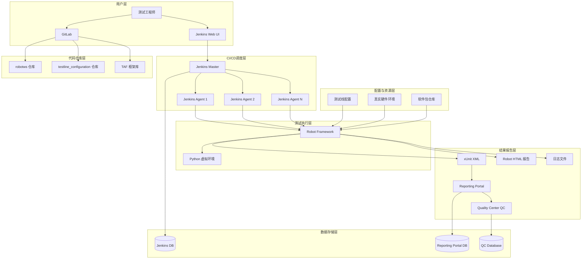
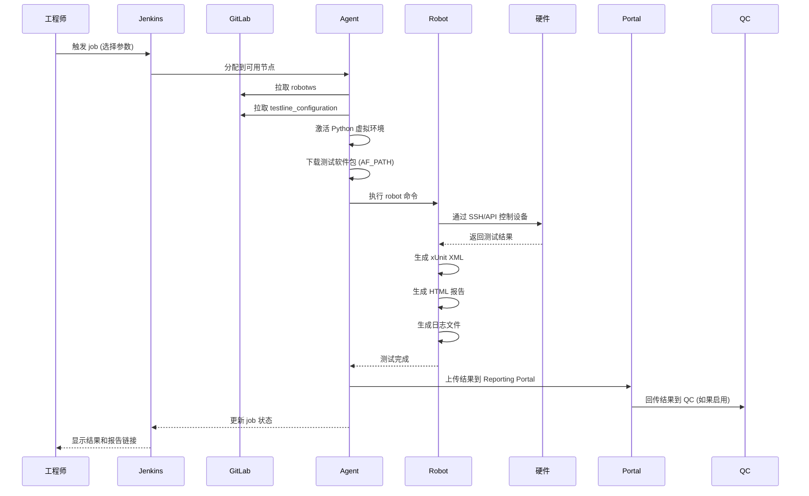
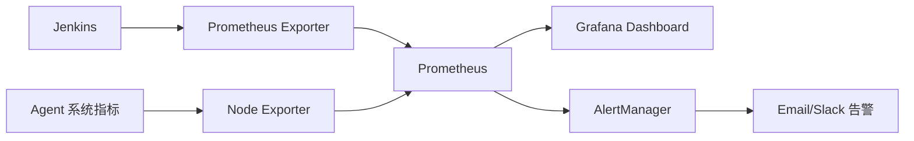
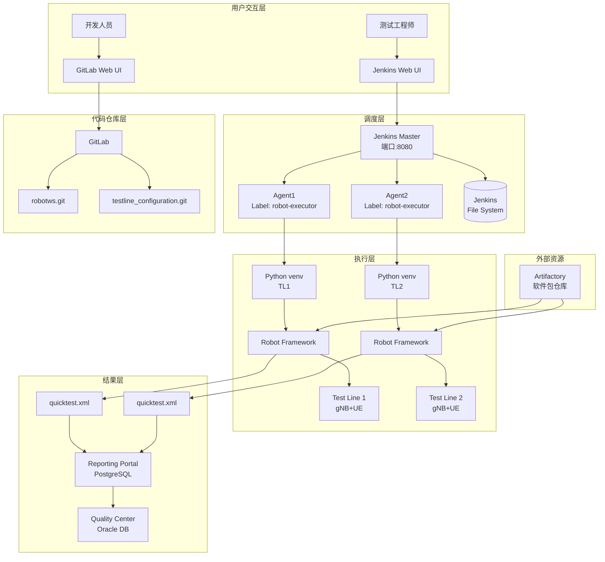

# Jenkins 自动化测试平台搭建方案

## 文档概述

本文档提供在新 Debian 服务器上从头搭建 Jenkins 集成测试自动化平台的完整技术方案，涵盖架构设计、技术选型、实施步骤和任务拆解。

---

## 一、系统架构分析

### 1.1 整体架构视图



### 1.2 核心组件说明

| 组件 | 职责 | 技术栈 |
| --- | --- | --- |
| **Jenkins Master** | 调度中心，管理 job 配置和执行触发 | Jenkins 2.x, Groovy Pipeline |
| **Jenkins Agent** | 实际执行测试的工作节点 | Python 3.10+, Robot Framework |
| **robotws** | 测试用例仓库，包含所有 Robot Framework 测试脚本 | Robot Framework, Python |
| **testline_configuration** | 测试线硬件拓扑配置仓库 | Python, TAF 配置类 |
| **TAF (Test Automation Framework)** | 测试自动化框架，提供硬件抽象和关键字库 | Python 库集合 |
| **Reporting Portal** | 测试结果聚合和可视化平台 | Web 应用 + 数据库 |
| **Quality Center (QC)** | 企业级测试管理系统 | HP ALM/QC |
| **GitLab** | 源代码版本控制 | GitLab CE/EE |
| **Artifact Repository** | 软件包存储（AF_PATH） | Artifactory / HTTP 服务器 |

### 1.3 数据流分析

#### 测试执行流程



### 1.4 关键设计原则

1. **测试线隔离**：每个测试线独立配置，避免资源冲突
2. **版本管理**：所有配置和测试用例版本化管理
3. **可追溯性**：从 Jenkins job 到 QC 全链路可追溯
4. **可扩展性**：支持水平扩展 Jenkins Agent
5. **失败重试**：支持 case 失败重跑机制
6. **并发执行**：多个测试线可并行执行

---

## 二、技术方案详解

### 2.1 服务器硬件与系统要求

#### 2.1.1 Jenkins Master 服务器

- **操作系统**：Debian 12 (Bookworm) 或 Ubuntu 22.04 LTS
- **CPU**：4 核心及以上
- **内存**：8 GB 及以上
- **磁盘**：200 GB SSD（用于 Jenkins home 目录）
- **网络**：千兆网卡，固定 IP

#### 2.1.2 Jenkins Agent 服务器（每个）

- **操作系统**：Debian 12 (Bookworm) 或 Ubuntu 22.04 LTS
- **CPU**：8 核心及以上（根据并发需求）
- **内存**：16 GB 及以上
- **磁盘**：500 GB SSD（存储测试结果和日志）
- **网络**：千兆网卡，能访问测试硬件设备

> **注意**：Agent 数量取决于测试线数量和并发需求，建议初期部署 3-5 个 Agent。

### 2.2 软件依赖清单

#### 2.2.1 系统级依赖

```bash
# 必装软件包
apt-get update
apt-get install -y \
    openjdk-17-jdk \
    python3.11 \
    python3.11-venv \
    python3-pip \
    git \
    openssh-server \
    curl \
    wget \
    vim \
    build-essential \
    libssl-dev \
    libffi-dev \
    python3-dev
```

#### 2.2.2 Jenkins 依赖

- **Jenkins LTS**：2.440+ (Long-Term Support 版本)
- **必装插件**：
  - Pipeline
  - Git plugin
  - SSH Agent Plugin
  - Credentials Binding Plugin
  - Blue Ocean (可选，提供现代化 UI)
  - JUnit Plugin
  - HTML Publisher Plugin
  - Workspace Cleanup Plugin
  - Timestamper Plugin
  - Build Timeout Plugin

#### 2.2.3 Python 依赖

根据 `robotws/requirements.cfg` 和 `dependencies.py*.lock` 安装：

```bash
# 核心依赖示例
pip install \
    robotframework>=6.0 \
    robotframework-seleniumlibrary \
    robotframework-sshlibrary \
    robotframework-requests \
    taf.config.testline>=8.228.0 \
    taf.sbts.oam.coam.admin>=2.120.0 \
    taf.gnb.oam.coam.admin>=4.1.2 \
    ute-reporting-portal>=7.47.0 \
    taf-sw-reporting-portal>=1.5.2 \
    pytest \
    pyarrow \
    attrs
```

> **重要**：使用 lock 文件确保依赖版本一致性：
> ```bash
> pip install -r dependencies.py311-rf50.lock
> ```

### 2.3 关键配置文件说明

#### 2.3.1 robotws 项目结构

```
robotws/
├── testsuite/              # 测试用例主目录
│   ├── Hangzhou/          # 按站点组织
│   ├── Bangalore/
│   ├── Beijing/
│   └── ...
├── requirements.cfg        # 手动维护的依赖清单
├── dependencies.py*.lock   # 自动生成的精确版本锁文件
├── sanity-checks/         # CI/CD 检查脚本
├── commissionings/        # 设备调试脚本
└── README.md
```

**核心职责**：
- 存储所有 Robot Framework 测试用例（.robot 文件）
- 定义 Python 依赖
- 提供测试资源和关键字库

#### 2.3.2 testline_configuration 项目结构

```
testline_configuration/
├── 7_5_UTE5G402T813/      # 按测试线命名
│   └── __init__.py        # 测试线拓扑配置
├── 1_16_CLOUD051/
│   └── __init__.py
└── ...
```

**配置示例** (`__init__.py`)：

```python
from taf.config.testline.gnb.gnb import CloudBts, CU
from taf.config.testline.ue import TM500, Airphone
from taf.config.testline.testline import TestLine
from taf.config.testline.connection_details import SshServiceDetails

# 定义基站
gnb = CloudBts(
    cu=CU(
        ssh=SshServiceDetails(
            addr="10.57.150.100",
            username="oam",
            password="oam"
        )
    ),
    # ... 其他配置
)

# 定义 UE
ue = TM500(
    ssh=SshServiceDetails(
        addr="10.57.150.200",
        username="root",
        password="spirent"
    )
)

# 组装测试线
tl = TestLine(
    name="7_5_UTE5G402T813",
    gnb=gnb,
    ues=[ue],
    # ... 其他资源
)
```

**核心职责**：
- 定义测试线硬件拓扑
- 配置设备连接信息（SSH、HTTP、BMC 等）
- 声明测试资源（基站、UE、PDU、开关、衰减器等）

#### 2.3.3 Jenkins Job 配置示例

**参数化构建参数**：

| 参数名 | 类型 | 说明 | 示例值 |
| --- | --- | --- | --- |
| `TESTLINE_NAME` | Choice | 测试线名称 | `7_5_UTE5G402T813` |
| `AF_PATH` | String | 软件包 URL | `http://10.101.54.7/SBTS00/...zip` |
| `TARGET_VERSION` | String | 目标软件版本 | `SBTS00_ENB_9999_260412_000003` |
| `CASE_NAME` | String | 测试用例名称（可用正则） | `05437018_EDA_UL_bler_verify*` |
| `UPLOAD_QC` | Choice | 是否上传 QC | `false` / `true` |
| `CASE_BRANCH` | String | robotws 分支 | `master` |
| `FDSW_OLD` | String | 旧 FDSW 版本 | `LN_WN_FDSW18A_*` |
| `FDSW_NEW` | String | 新 FDSW 版本 | `LN_WN_FDSW19_*` |

### 2.4 数据库使用情况

#### 2.4.1 Jenkins 数据存储

Jenkins 本身使用 **文件系统存储**（非传统数据库）：

- **存储位置**：`/var/lib/jenkins/` (Jenkins Home)
- **存储内容**：
  - Job 配置（XML 文件）
  - 构建历史
  - 插件数据
  - 用户权限配置

**备份策略**：
```bash
# 定期备份 Jenkins Home
tar -czf jenkins_backup_$(date +%Y%m%d).tar.gz /var/lib/jenkins/
```

#### 2.4.2 Reporting Portal 数据库

Reporting Portal 需要 **关系型数据库**：

- **推荐数据库**：PostgreSQL 14+ 或 MySQL 8.0+
- **存储内容**：
  - 测试执行记录
  - 测试结果统计
  - SCF (System Configuration File) ID
  - 与 QC 的关联关系

**表结构示例**：

```sql
CREATE TABLE test_executions (
    id SERIAL PRIMARY KEY,
    tc_execution_id VARCHAR(255),  -- SCF ID
    test_name VARCHAR(500),
    result VARCHAR(20),            -- PASSED/FAILED
    testline VARCHAR(100),
    build VARCHAR(100),
    qc_domain VARCHAR(50),
    qc_project VARCHAR(50),
    qc_id VARCHAR(50),
    execution_time TIMESTAMP,
    duration INT,
    log_path TEXT
);
```

#### 2.4.3 QC (Quality Center) 数据库

QC 使用 **企业级商业数据库**（通常为 Oracle 或 SQL Server），由 QC/ALM 系统管理。

**集成方式**：
- 通过 QC REST API 上传结果
- 使用 `ute-reporting-portal` 库作为中间层
- 映射关系：`qc_id` ↔ `test_name` ↔ `execution_id`

### 2.5 关键执行流程详解

#### 2.5.1 Jenkins Job 执行命令解析

```bash
# 1. 激活虚拟环境
/home/ute/CIENV/7_5_UTE5G402T813/bin/activate

# 2. 执行 Robot Framework
http_proxy= https_proxy= python -m robot \
  # Python 路径：添加 robotws 到 sys.path
  --pythonpath /opt/workspace/robotws \
  
  # 变量传递：传递给 Robot 测试用例
  -v AF_PATH:http://10.101.54.7/SBTS00/xxx.zip \
  -v target_version:SBTS00_ENB_9999_260412_000003 \
  -v testline_name:7_5_UTE5G402T813 \
  -v fdswOld:LN_WN_FDSW18A_0000_100164_000000 \
  -v fdswNew:LN_WN_FDSW19_0000_000154_000000 \
  -v uploadQC:false \
  -v caseBranch:stella_tmo_0323 \
  
  # 输出配置
  -x quicktest.xml \              # xUnit 格式输出
  -b debug.log \                  # Debug 日志
  -d artifact/quicktest/retry-0/  # 输出目录
  
  # 测试线配置：从文件加载变量
  -V testline_configuration/7_5_UTE5G402T813 \
  
  # 日志级别
  -L TRACE \
  
  # 测试用例选择：通过名称过滤
  -t 05437018_EDA_UL_bler_verify_after_scell_released \
  
  # 测试套件路径
  robotws/testsuite/Hangzhou/RRM/.../TMO_E2E_Reproduction_CRT.robot
```

**参数说明**：

| 参数 | 含义 | 作用 |
| --- | --- | --- |
| `--pythonpath` | Python 搜索路径 | 让 Robot 能导入 robotws 中的库 |
| `-v` | 变量定义 | 传递给测试用例的变量 |
| `-V` | 变量文件 | 从 Python 模块加载配置（testline config） |
| `-x` | xUnit 输出 | 生成 Jenkins 可解析的 XML |
| `-b` | Debug 日志 | 记录详细调试信息 |
| `-d` | 输出目录 | 所有输出文件存放位置 |
| `-L` | 日志级别 | TRACE/DEBUG/INFO/WARN |
| `-t` | 测试用例过滤 | 按名称选择要执行的用例 |

#### 2.5.2 Reporting Portal 集成流程

在测试用例中使用 `ute_reporting_portal` 库：

```robot
*** Settings ***
Library    ute_reporting_portal

*** Keywords ***
Suite Teardown Reporting
    # 1. 获取 SW 版本信息
    ${build}=    coam.get_sw_version    connection=rp
    
    # 2. 遍历测试结果
    FOR    ${test_name}   IN    @{test_results.keys()}
        # 3. 上传到 Reporting Portal
        ute_reporting_portal.Report To Rp
            ...    name=${test_name}
            ...    result=${test_results['${test_name}']}
            ...    testline=${testline_name}
            ...    build=${build}
            ...    qc_domain=MN_RAN
            ...    qc_project=RAN_VRF
            ...    qc_id=${qc_id}
            ...    tc_execution_id=${scf_id}
    END
```

**数据流向**：
```
Robot Test → ute_reporting_portal → Reporting Portal API → PostgreSQL
                                                          ↓
                                                       QC API → QC Database
```

---

## 三、架构设计

### 3.1 网络拓扑设计

```
                        ┌─────────────────────────────────┐
                        │   Internet / Corporate Network  │
                        └────────────┬────────────────────┘
                                     │
                        ┌────────────▼────────────────┐
                        │    Reverse Proxy (Nginx)    │
                        │   https://jenkins.company   │
                        └────────────┬────────────────┘
                                     │
                        ┌────────────▼────────────────┐
                        │     Jenkins Master          │
                        │   IP: 10.101.54.5           │
                        │   Port: 8080                │
                        └─┬──────────┬────────────┬───┘
                          │          │            │
        ┌─────────────────┘          │            └─────────────────┐
        │                            │                              │
┌───────▼────────┐       ┌──────────▼───────┐       ┌─────────────▼──────┐
│ Jenkins Agent1 │       │ Jenkins Agent2   │       │  Jenkins Agent N   │
│ 10.101.54.101  │       │ 10.101.54.102    │       │  10.101.54.10N     │
└───────┬────────┘       └──────────┬───────┘       └─────────────┬──────┘
        │                           │                              │
        │                           │                              │
    ┌───▼─────────────────────────┬─▼──────────────────────────┬───▼───────┐
    │   Test Hardware Network     │                            │           │
    │                             │                            │           │
┌───▼──────┐  ┌────────┐  ┌──────▼─────┐  ┌──────────┐  ┌─────▼────────┐
│ gNB      │  │ eNB    │  │ UE (TM500) │  │ Core Net │  │ PDU/Switch   │
│ TL813    │  │ TL284  │  │ Airphone   │  │ EPCSim   │  │ Attenuator   │
└──────────┘  └────────┘  └────────────┘  └──────────┘  └──────────────┘
```

**网络分区**：

1. **管理网络**（10.101.54.0/24）
   - Jenkins Master/Agent
   - GitLab
   - Reporting Portal

2. **测试网络**（10.57.150.0/24）
   - 测试硬件设备
   - Agent 需要双网卡访问

3. **外部网络**
   - 软件包仓库（Artifactory）
   - QC 服务器

### 3.2 安全架构设计

#### 3.2.1 认证与授权

- **Jenkins 用户管理**：
  - 集成 LDAP/Active Directory
  - 基于角色的访问控制（RBAC）
  - 配置 Matrix Authorization Strategy

- **SSH 密钥管理**：
  - 使用 Jenkins Credentials 存储私钥
  - 每个测试线独立的 SSH 密钥对
  - 定期轮换密钥

- **API Token**：
  - Reporting Portal API Token
  - QC API 认证凭据
  - 存储在 Jenkins Credentials

#### 3.2.2 网络安全

```bash
# 防火墙规则示例（iptables）
# 允许 Jenkins Master 访问 Agent SSH
iptables -A INPUT -p tcp --dport 22 -s 10.101.54.5 -j ACCEPT

# 允许 Agent 访问测试设备
iptables -A OUTPUT -p tcp -d 10.57.150.0/24 -j ACCEPT

# 允许访问 GitLab
iptables -A OUTPUT -p tcp --dport 443 -d <gitlab-ip> -j ACCEPT
```

#### 3.2.3 数据安全

- **敏感信息加密**：
  - 密码通过 Jenkins Credentials 加密存储
  - `testline_configuration` 中的密码使用环境变量

- **日志脱敏**：
  - 避免在日志中打印明文密码
  - Robot Framework 设置 `Set Log Level    NONE` 对敏感操作

### 3.3 高可用性设计

#### 3.3.1 Jenkins Master 高可用

**主从架构**（适用于大规模场景）：

```
┌─────────────────┐       ┌─────────────────┐
│ Jenkins Master1 │◄─────►│ Jenkins Master2 │
│   (Active)      │       │   (Standby)     │
└────────┬────────┘       └────────┬────────┘
         │                         │
         └──────────┬──────────────┘
                    │
              ┌─────▼──────┐
              │  Shared NFS│
              │ Jenkins Home│
              └────────────┘
```

**备份策略**：
- 每日备份 Jenkins Home 到外部存储
- 配置文件版本化存储在 GitLab

#### 3.3.2 Agent 弹性扩展

- **容器化部署**（可选）：
  ```yaml
  # docker-compose.yml
  version: '3'
  services:
    jenkins-agent:
      image: jenkins/jnlp-agent:latest
      environment:
        - JENKINS_URL=http://10.101.54.5:8080
        - JENKINS_AGENT_NAME=agent-dynamic-1
        - JENKINS_SECRET=<agent-secret>
  ```

- **动态 Agent**：
  - 使用 Kubernetes/Docker 插件动态创建 Agent
  - 根据负载自动扩缩容

### 3.4 监控与告警架构



**监控指标**：
- Jenkins job 成功率
- 平均执行时间
- Agent 资源使用率（CPU、内存、磁盘）
- 测试线可用性

---

## 四、任务拆解与实施步骤

### 4.1 项目阶段划分

| 阶段 | 时间 | 产出 |
| --- | --- | --- |
| **准备阶段** | 1 周 | 服务器就绪，软件依赖安装 |
| **基础设施搭建** | 2 周 | Jenkins、GitLab、数据库部署 |
| **集成开发** | 3 周 | robotws/testline_configuration 集成 |
| **测试验证** | 2 周 | 端到端流程打通 |
| **优化与上线** | 1 周 | 性能优化，生产环境部署 |

**总计**：约 9 周（约 2 个月）

### 4.2 详细任务清单

#### 阶段 1：准备阶段（Week 1）

**任务 1.1：服务器准备**
- [ ] 申请 1 台 Jenkins Master 服务器（Debian 12）
- [ ] 申请 3 台 Jenkins Agent 服务器（Debian 12）
- [ ] 配置静态 IP 和主机名
- [ ] 配置 SSH 免密登录（Master → Agents）
- [ ] 设置防火墙规则

**任务 1.2：系统初始化**
```bash
# 在所有服务器上执行
apt-get update && apt-get upgrade -y
apt-get install -y openjdk-17-jdk python3.11 python3.11-venv git curl

# 创建 jenkins 用户
useradd -m -s /bin/bash jenkins
echo "jenkins ALL=(ALL) NOPASSWD:ALL" >> /etc/sudoers
```

**任务 1.3：网络与存储规划**
- [ ] 配置测试硬件网络路由（Agent 双网卡）
- [ ] 挂载 NFS 共享存储（用于 artifact 存储）
- [ ] 配置 DNS 解析（jenkins.company.com）

#### 阶段 2：基础设施搭建（Week 2-3）

**任务 2.1：安装 Jenkins Master**

```bash
# 添加 Jenkins 官方仓库
wget -q -O - https://pkg.jenkins.io/debian-stable/jenkins.io.key | apt-key add -
echo "deb https://pkg.jenkins.io/debian-stable binary/" >> /etc/apt/sources.list.d/jenkins.list
apt-get update
apt-get install jenkins

# 启动 Jenkins
systemctl start jenkins
systemctl enable jenkins

# 获取初始密码
cat /var/lib/jenkins/secrets/initialAdminPassword
```

访问 `http://<master-ip>:8080`，完成初始化向导。

**任务 2.2：安装必要插件**
```groovy
// 通过 Jenkins Script Console 批量安装插件
def plugins = [
    'git',
    'workflow-aggregator',
    'ssh-agent',
    'credentials-binding',
    'junit',
    'htmlpublisher',
    'ws-cleanup',
    'timestamper',
    'build-timeout',
    'email-ext'
]
plugins.each { plugin ->
    Jenkins.instance.updateCenter.getPlugin(plugin).deploy()
}
Jenkins.instance.save()
```

**任务 2.3：配置 Jenkins Agent**

在 Master 上添加 Agent 节点：
1. 进入 `Manage Jenkins` → `Manage Nodes and Clouds` → `New Node`
2. 配置：
   - Name: `agent-1`
   - Remote root directory: `/home/jenkins/workspace`
   - Labels: `robot-executor linux`
   - Launch method: `Launch agents via SSH`
   - Host: `10.101.54.101`
   - Credentials: 添加 SSH 私钥

**任务 2.4：部署 GitLab（或使用现有）**

```bash
# 使用 Docker 快速部署 GitLab
docker run -d \
  --hostname gitlab.company.com \
  -p 443:443 -p 80:80 -p 22:22 \
  --name gitlab \
  --restart always \
  --volume /srv/gitlab/config:/etc/gitlab \
  --volume /srv/gitlab/logs:/var/log/gitlab \
  --volume /srv/gitlab/data:/var/opt/gitlab \
  gitlab/gitlab-ce:latest
```

**任务 2.5：部署 Reporting Portal 数据库**

```bash
# 安装 PostgreSQL
apt-get install postgresql-14

# 创建数据库
sudo -u postgres psql
CREATE DATABASE reporting_portal;
CREATE USER rp_user WITH PASSWORD 'secure_password';
GRANT ALL PRIVILEGES ON DATABASE reporting_portal TO rp_user;
```

**任务 2.6：配置 Reporting Portal**

假设 Reporting Portal 是 Python Web 应用：
```bash
# 在专用服务器上
git clone <reporting-portal-repo>
cd reporting-portal
python3 -m venv venv
source venv/bin/activate
pip install -r requirements.txt

# 配置数据库连接
export DB_HOST=localhost
export DB_NAME=reporting_portal
export DB_USER=rp_user
export DB_PASSWORD=secure_password

# 初始化数据库
python manage.py migrate

# 启动服务
gunicorn -b 0.0.0.0:8000 wsgi:app
```

#### 阶段 3：集成开发（Week 4-6）

**任务 3.1：设置 Git 仓库**

在 GitLab 上创建两个仓库：
- `robotws`
- `testline_configuration`

迁移现有代码：
```bash
cd /path/to/existing/robotws
git init
git remote add origin git@gitlab.company.com:testing/robotws.git
git add .
git commit -m "Initial commit"
git push -u origin master

# 同样操作 testline_configuration
```

**任务 3.2：配置 Agent Python 环境**

在每个 Agent 上：
```bash
# 为每个测试线创建独立虚拟环境
TESTLINE_NAME="7_5_UTE5G402T813"
mkdir -p /home/ute/CIENV
python3.11 -m venv /home/ute/CIENV/${TESTLINE_NAME}
source /home/ute/CIENV/${TESTLINE_NAME}/bin/activate

# 克隆 robotws
git clone git@gitlab.company.com:testing/robotws.git /opt/robotws

# 安装依赖
cd /opt/robotws
pip install -r dependencies.py311-rf50.lock

# 验证安装
python -m robot.libdoc ute_reporting_portal
```

**任务 3.3：创建 Jenkins Pipeline 模板**

创建 `Jenkinsfile` 模板：

```groovy
pipeline {
    agent { label 'robot-executor' }
    
    parameters {
        choice(name: 'TESTLINE_NAME', choices: ['7_5_UTE5G402T813', '1_16_CLOUD051'], description: '选择测试线')
        string(name: 'AF_PATH', defaultValue: '', description: '软件包下载路径')
        string(name: 'TARGET_VERSION', defaultValue: '', description: '目标版本')
        string(name: 'CASE_NAME', defaultValue: '', description: '测试用例名称（支持正则）')
        choice(name: 'UPLOAD_QC', choices: ['false', 'true'], description: '是否上传 QC')
        string(name: 'CASE_BRANCH', defaultValue: 'master', description: 'robotws 分支')
    }
    
    environment {
        VENV_PATH = "/home/ute/CIENV/${params.TESTLINE_NAME}"
        WORKSPACE_ROOT = "${WORKSPACE}"
    }
    
    stages {
        stage('Checkout') {
            steps {
                checkout([
                    $class: 'GitSCM',
                    branches: [[name: "*/${params.CASE_BRANCH}"]],
                    userRemoteConfigs: [[url: 'git@gitlab:testing/robotws.git']]
                ])
                dir('testline_configuration') {
                    checkout([
                        $class: 'GitSCM',
                        branches: [[name: '*/master']],
                        userRemoteConfigs: [[url: 'git@gitlab:testing/testline_configuration.git']]
                    ])
                }
            }
        }
        
        stage('Prepare Environment') {
            steps {
                sh '''
                    source ${VENV_PATH}/bin/activate
                    pip list
                '''
            }
        }
        
        stage('Execute Tests') {
            steps {
                sh '''
                    source ${VENV_PATH}/bin/activate
                    
                    http_proxy= https_proxy= python -m robot \
                        --pythonpath ${WORKSPACE_ROOT}/robotws \
                        -v AF_PATH:${AF_PATH} \
                        -v target_version:${TARGET_VERSION} \
                        -v testline_name:${TESTLINE_NAME} \
                        -v uploadQC:${UPLOAD_QC} \
                        -v caseBranch:${CASE_BRANCH} \
                        -x quicktest.xml \
                        -b debug.log \
                        -d ${WORKSPACE_ROOT}/artifact \
                        -V testline_configuration/${TESTLINE_NAME} \
                        -L TRACE \
                        -t ${CASE_NAME} \
                        robotws/testsuite/**/*.robot
                '''
            }
        }
        
        stage('Publish Results') {
            steps {
                junit 'artifact/quicktest.xml'
                publishHTML([
                    reportDir: 'artifact',
                    reportFiles: 'log.html',
                    reportName: 'Robot Framework Report'
                ])
            }
        }
    }
    
    post {
        always {
            archiveArtifacts artifacts: 'artifact/**/*', allowEmptyArchive: true
            cleanWs()
        }
        failure {
            emailext(
                subject: "测试失败: ${env.JOB_NAME} #${env.BUILD_NUMBER}",
                body: "请查看: ${env.BUILD_URL}",
                to: 'team@company.com'
            )
        }
    }
}
```

**任务 3.4：配置 Reporting Portal 集成**

在 Agent 上配置环境变量：
```bash
# /home/ute/CIENV/<testline>/bin/activate 中添加
export REPORTING_PORTAL_URL=http://10.101.54.200:8000
export REPORTING_PORTAL_TOKEN=<api-token>
export QC_URL=http://qc.company.com
export QC_USERNAME=admin
export QC_PASSWORD=<password>
```

在 Robot Framework 资源文件中：
```robot
*** Settings ***
Library    ute_reporting_portal
...    url=${REPORTING_PORTAL_URL}
...    token=${REPORTING_PORTAL_TOKEN}
```

**任务 3.5：实现失败重试机制**

在 Pipeline 中添加重试逻辑：
```groovy
stage('Execute Tests with Retry') {
    steps {
        script {
            def maxRetries = 3
            def currentRetry = 0
            def success = false
            
            while (currentRetry < maxRetries && !success) {
                try {
                    sh '''
                        # robot 命令...
                        -d ${WORKSPACE_ROOT}/artifact/retry-${currentRetry}
                    '''
                    success = true
                } catch (Exception e) {
                    currentRetry++
                    echo "测试失败，重试 ${currentRetry}/${maxRetries}"
                }
            }
            
            if (!success) {
                error("测试在 ${maxRetries} 次重试后仍然失败")
            }
        }
    }
}
```

#### 阶段 4：测试验证（Week 7-8）

**任务 4.1：单元测试**
- [ ] 验证每个 testline_configuration 能正确加载
- [ ] 验证 Python 依赖完整性
- [ ] 验证 SSH 连接到测试设备

**任务 4.2：集成测试**
- [ ] 执行一个简单的 smoke test
- [ ] 验证 Jenkins → Agent → Robot → 硬件全链路
- [ ] 验证日志和报告生成

**任务 4.3：端到端测试**
- [ ] 执行完整的 regression suite
- [ ] 验证 Reporting Portal 数据上传
- [ ] 验证 QC 集成（如果启用）

**任务 4.4：性能测试**
- [ ] 并发执行多个测试线
- [ ] 监控 Agent 资源使用
- [ ] 评估单 Agent 最大并发数

#### 阶段 5：优化与上线（Week 9）

**任务 5.1：性能优化**
- [ ] 优化 Robot Framework 关键字性能
- [ ] 配置测试结果压缩归档
- [ ] 清理历史构建（保留策略）

**任务 5.2：文档编写**
- [ ] 编写用户操作手册
- [ ] 编写管理员运维手册
- [ ] 编写故障排查指南

**任务 5.3：培训与交接**
- [ ] 向测试团队演示系统使用
- [ ] 培训 Jenkins 管理员
- [ ] 交接系统管理密钥和凭据

**任务 5.4：生产环境部署**
- [ ] 迁移 Jenkins Master 到生产环境
- [ ] 配置 HTTPS 和域名
- [ ] 配置自动备份策略
- [ ] 设置监控和告警

### 4.3 关键里程碑

| 里程碑 | 日期 | 验收标准 |
| --- | --- | --- |
| **M1: 基础设施就绪** | Week 3 | Jenkins Master/Agent 可访问，GitLab 运行 |
| **M2: 首个测试执行成功** | Week 5 | 通过 Jenkins 触发一个 Robot case 并成功 |
| **M3: 端到端流程打通** | Week 7 | 测试结果从 Jenkins → Reporting Portal → QC 全流程 |
| **M4: 生产环境上线** | Week 9 | 系统在生产环境稳定运行 1 周无故障 |

---

## 五、运维与故障排查

### 5.1 常见问题及解决方案

#### 问题 1：Agent 连接失败

**现象**：
```
ERROR: Connection refused: connect
```

**排查步骤**：
1. 检查 Agent SSH 服务：`systemctl status sshd`
2. 验证防火墙规则：`iptables -L -n`
3. 测试 SSH 连接：`ssh jenkins@<agent-ip>`
4. 检查 Jenkins Agent 日志：`/var/lib/jenkins/logs/slaves/<agent-name>/`

**解决方案**：
```bash
# 重启 sshd
systemctl restart sshd

# 添加防火墙规则
iptables -A INPUT -p tcp --dport 22 -s <jenkins-master-ip> -j ACCEPT
```

#### 问题 2：Robot 执行失败 "Module not found"

**现象**：
```
ModuleNotFoundError: No module named 'taf.config.testline'
```

**排查步骤**：
1. 检查虚拟环境激活：`which python`
2. 验证依赖安装：`pip list | grep taf`
3. 检查 PYTHONPATH：`echo $PYTHONPATH`

**解决方案**：
```bash
# 重新安装依赖
source /home/ute/CIENV/<testline>/bin/activate
pip install -r dependencies.py311-rf50.lock --force-reinstall
```

#### 问题 3：测试线配置加载失败

**现象**：
```
ImportError: No module named '__init__'
```

**排查步骤**：
1. 检查 testline_configuration 路径是否正确
2. 验证 `__init__.py` 文件语法：`python -m py_compile testline_configuration/<tl>/__init__.py`
3. 检查权限：`ls -l testline_configuration/<tl>/`

**解决方案**：
```bash
# 确保路径正确
ls -d testline_configuration/7_5_UTE5G402T813/__init__.py

# 修正权限
chmod 644 testline_configuration/7_5_UTE5G402T813/__init__.py
```

#### 问题 4：Reporting Portal 上传失败

**现象**：
```
HTTPError: 401 Unauthorized
```

**排查步骤**：
1. 检查 API Token 是否过期
2. 验证 Reporting Portal 服务状态：`curl http://<portal-url>/health`
3. 检查网络连通性：`telnet <portal-ip> 8000`

**解决方案**：
```bash
# 更新 API Token
export REPORTING_PORTAL_TOKEN=<new-token>

# 重启 Reporting Portal 服务
systemctl restart reporting-portal
```

### 5.2 日常维护任务

#### 每日
- [ ] 检查 Jenkins 构建队列是否阻塞
- [ ] 查看失败的 job 并分类故障原因
- [ ] 清理超过 7 天的 artifact

#### 每周
- [ ] 备份 Jenkins Home 目录
- [ ] 更新 robotws 和 testline_configuration 仓库
- [ ] 检查 Agent 磁盘使用率

#### 每月
- [ ] 更新 Jenkins 和插件
- [ ] 审计用户权限
- [ ] 性能分析和优化

### 5.3 监控告警配置

使用 Prometheus + Grafana 监控：

```yaml
# prometheus.yml
scrape_configs:
  - job_name: 'jenkins'
    metrics_path: '/prometheus'
    static_configs:
      - targets: ['10.101.54.5:8080']
  
  - job_name: 'agents'
    static_configs:
      - targets: 
        - '10.101.54.101:9100'
        - '10.101.54.102:9100'
```

告警规则：
```yaml
# alert.rules
groups:
  - name: jenkins_alerts
    rules:
      - alert: JenkinsDown
        expr: up{job="jenkins"} == 0
        for: 5m
        annotations:
          summary: "Jenkins Master 宕机"
      
      - alert: HighFailureRate
        expr: rate(jenkins_job_failure_total[1h]) > 0.5
        annotations:
          summary: "测试失败率过高"
      
      - alert: AgentDiskFull
        expr: node_filesystem_avail_bytes{mountpoint="/"} / node_filesystem_size_bytes < 0.1
        annotations:
          summary: "Agent 磁盘空间不足 10%"
```

---

## 六、成本估算

### 6.1 硬件成本

| 项目 | 数量 | 单价（USD） | 小计（USD） |
| --- | --- | --- | --- |
| Jenkins Master 服务器 | 1 | $1,500 | $1,500 |
| Jenkins Agent 服务器 | 3 | $2,000 | $6,000 |
| 网络设备（交换机等） | 1 | $800 | $800 |
| **硬件总计** | - | - | **$8,300** |

### 6.2 软件成本（首年）

| 项目 | 数量 | 单价（USD） | 小计（USD） |
| --- | --- | --- | --- |
| Debian/Ubuntu 系统 | N/A | 免费 | $0 |
| Jenkins | N/A | 免费（开源） | $0 |
| GitLab CE | N/A | 免费 | $0 |
| PostgreSQL | N/A | 免费 | $0 |
| QC/ALM 许可证 | 10 用户 | $500/用户/年 | $5,000 |
| Reporting Portal | N/A | 内部开发 | $0 |
| **软件总计** | - | - | **$5,000** |

### 6.3 人力成本

| 角色 | 人数 | 周期 | 日薪（USD） | 小计（USD） |
| --- | --- | --- | --- | --- |
| DevOps 工程师 | 1 | 9 周 | $350 | $15,750 |
| 测试开发工程师 | 2 | 6 周 | $300 | $18,000 |
| 系统管理员 | 1 | 3 周 | $250 | $3,750 |
| **人力总计** | - | - | - | **$37,500** |

### 6.4 总投资

| 类别 | 金额（USD） |
| --- | --- |
| 硬件 | $8,300 |
| 软件 | $5,000 |
| 人力 | $37,500 |
| **总计** | **$50,800** |

---

## 七、附录

### 7.1 参考架构图

完整的组件交互图（详细版）：



### 7.2 关键文件模板

#### 7.2.1 测试线配置模板

`testline_configuration/TEMPLATE/__init__.py`:

```python
"""
测试线配置模板
维护者：<your-name>
邮箱：<your-email>
"""
import os
from taf.config.testline.testline import TestLine
from taf.config.testline.gnb.gnb import CloudBts, CU
from taf.config.testline.ue import TM500
from taf.config.testline.connection_details import SshServiceDetails

__maintainer__ = "Your Name"
__email__ = "your.email@company.com"

# 基站配置
gnb = CloudBts(
    cu=CU(
        ssh=SshServiceDetails(
            addr=os.getenv("GNB_IP", "10.57.150.100"),
            username=os.getenv("GNB_USER", "oam"),
            password=os.getenv("GNB_PASSWORD", "oam")
        )
    )
)

# UE 配置
ue = TM500(
    ssh=SshServiceDetails(
        addr=os.getenv("UE_IP", "10.57.150.200"),
        username="root",
        password=os.getenv("UE_PASSWORD", "spirent")
    )
)

# 测试线对象
tl = TestLine(
    name="TEMPLATE",
    gnb=gnb,
    ues=[ue]
)

__all__ = ["tl"]
```

#### 7.2.2 Robot Framework 测试模板

`robotws/testsuite/TEMPLATE/example.robot`:

```robot
*** Settings ***
Documentation    测试模板
...              作者: Your Name <your.email@company.com>
...              描述: 这是一个测试模板
Suite Setup      Suite Setup Keywords
Suite Teardown   Suite Teardown Keywords
Test Teardown    Test Teardown Keywords
Force Tags       TEMPLATE    REGRESSION

Library          ute_reporting_portal
Resource         common_keywords.robot

*** Variables ***
${TEST_TIMEOUT}    300s
${LOG_LEVEL}       DEBUG

*** Test Cases ***
示例测试用例_01
    [Documentation]    这是一个示例测试用例
    [Tags]    SMOKE
    [Timeout]    ${TEST_TIMEOUT}
    
    Log To Console    \n开始测试...
    执行测试步骤 1
    执行测试步骤 2
    验证测试结果
    Log To Console    \n测试完成

*** Keywords ***
Suite Setup Keywords
    Log To Console    \n=== Suite Setup ===
    初始化测试环境
    连接测试设备

Suite Teardown Keywords
    Log To Console    \n=== Suite Teardown ===
    上传测试结果
    清理测试环境

Test Teardown Keywords
    Log    测试用例执行完成: ${TEST NAME}
    记录测试结果    ${TEST NAME}    ${TEST STATUS}

执行测试步骤 1
    Log    执行步骤 1
    # 具体实现

执行测试步骤 2
    Log    执行步骤 2
    # 具体实现

验证测试结果
    Log    验证结果
    # 具体实现

记录测试结果
    [Arguments]    ${name}    ${status}
    ${results}    Get Variable Value    ${SUITE_RESULTS}    {}
    Set To Dictionary    ${results}    ${name}=${status}
    Set Suite Variable    ${SUITE_RESULTS}    ${results}

上传测试结果
    ${build}    Get SW Version
    FOR    ${test_name}    IN    @{SUITE_RESULTS.keys()}
        ute_reporting_portal.Report To Rp
        ...    name=${test_name}
        ...    result=${SUITE_RESULTS['${test_name}']}
        ...    testline=${testline_name}
        ...    build=${build}
        ...    qc_domain=YOUR_DOMAIN
        ...    qc_project=YOUR_PROJECT
        ...    qc_id=${QC_ID}
    END
```

### 7.3 有用的命令参考

#### Jenkins CLI 操作

```bash
# 下载 Jenkins CLI
wget http://10.101.54.5:8080/jnlpJars/jenkins-cli.jar

# 触发 job
java -jar jenkins-cli.jar -s http://10.101.54.5:8080/ \
    -auth admin:password \
    build "TestJob" -p TESTLINE_NAME=7_5_UTE5G402T813

# 获取 job 状态
java -jar jenkins-cli.jar -s http://10.101.54.5:8080/ \
    -auth admin:password \
    get-job "TestJob"
```

#### Robot Framework 命令

```bash
# 列出所有测试用例
robot --dryrun -d /tmp testsuite/

# 只运行特定标签的用例
robot -i SMOKE testsuite/

# 重新执行失败的用例
robot --rerunfailed output.xml --output rerun.xml testsuite/

# 合并多次执行结果
rebot --merge output1.xml output2.xml
```

#### Git 操作

```bash
# 创建新分支进行测试开发
git checkout -b feature/new-test-case

# 更新子模块（如果使用）
git submodule update --recursive --remote

# 查看提交历史
git log --oneline --graph --all
```

### 7.4 相关文档链接

- Jenkins 官方文档：https://www.jenkins.io/doc/
- Robot Framework 用户指南：https://robotframework.org/robotframework/latest/RobotFrameworkUserGuide.html
- TAF 框架文档（内部）：http://nok.it/TAF
- Reporting Portal API 文档（内部）：http://reporting.company.com/docs
- QC/ALM REST API：https://admhelp.microfocus.com/alm/api_refs/REST/

---

## 八、总结

本技术方案提供了在 Debian 服务器上从头搭建 Jenkins 自动化测试平台的完整指南，涵盖：

1. **架构设计**：清晰的分层架构，支持扩展和高可用
2. **技术选型**：开源为主，成本可控，技术栈成熟
3. **实施路径**：9 周分阶段实施，风险可控
4. **运维支持**：详细的故障排查和维护指南

**核心优势**：
- ✅ 基于开源技术，无厂商锁定
- ✅ 支持大规模并发测试执行
- ✅ 完整的结果追溯链路（Jenkins → RP → QC）
- ✅ 模块化设计，易于扩展新测试线

**预期收益**：
- 自动化率提升至 90%+
- 测试执行效率提升 5 倍
- 人工回归测试时间减少 80%
- 问题发现周期缩短至 24 小时内

**下一步行动**：
1. 获取管理层批准和预算
2. 采购服务器硬件
3. 组建项目团队
4. 启动阶段 1 准备工作

---

**文档版本**：v1.0  
**编写日期**：2026-04-14  
**作者**：GitHub Copilot  
**审核人**：待定  
**更新历史**：
- v1.0 (2026-04-14): 初始版本
