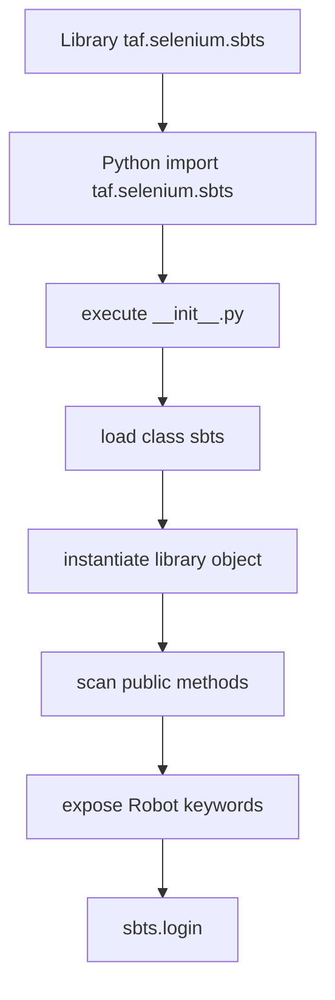
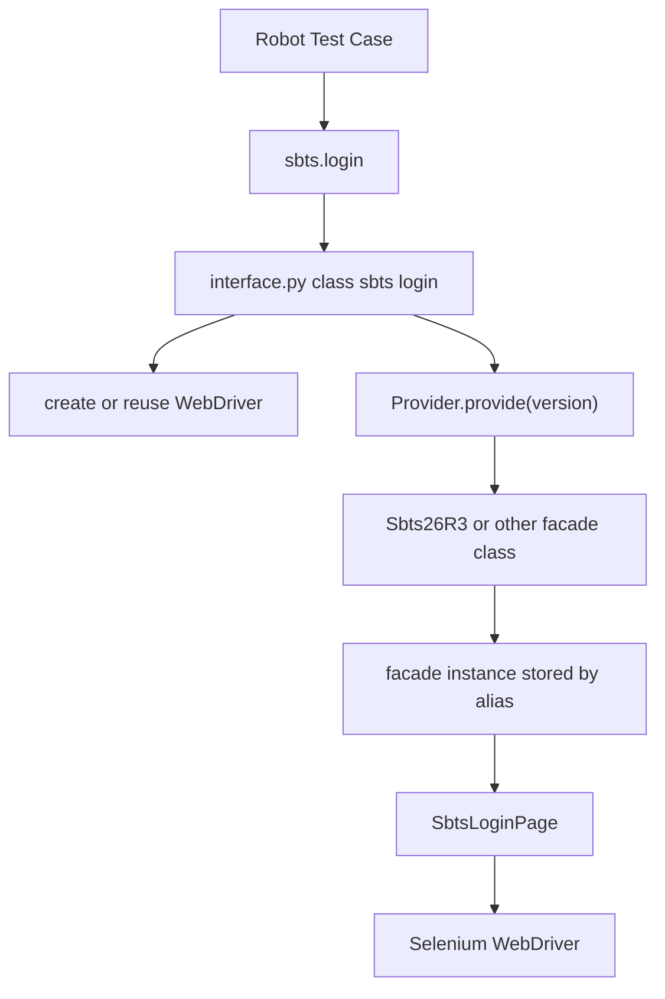
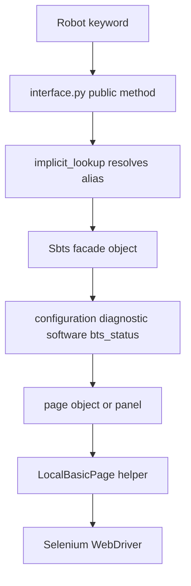

# Robot Framework 调用 TAF 库机制说明

## 1. 文档目标

本文以本地 Selenium SBTS TAF 库为例：

`C:\TA\site-packages\taf\selenium\sbts`

说明 Robot Framework 是如何识别并调用 Python TAF 库的，包括：

- Robot 用例中的 `Library    taf.selenium.sbts    WITH NAME    sbts` 如何找到 Python 包。
- 为什么 keyword 会对应到 `interface.py` 里的方法。
- `__init__.py`、`interface.py`、facade、page object 各自承担什么职责。
- TAF 自己的 alias / session 管理如何让多个 SBTS 会话复用同一套关键字。
- 如果自己写一个新的底层 TAF 库，建议包含哪些基础结构。

## 2. Robot Framework 调用 Python Library 的基本过程

Robot Framework 支持直接把 Python module 或 Python class 当作测试库导入。对于如下 Robot 写法：

```robotframework
*** Settings ***
Library    taf.selenium.sbts    WITH NAME    sbts
```

Robot 大致会做几件事：

1. 根据 Python import 规则查找 `taf.selenium.sbts`。
2. 找到对应 Python package 目录，也就是 `taf/selenium/sbts/`。
3. 执行该 package 下的 `__init__.py`。
4. 从导入结果中找到可作为 library 的类或对象。
5. 实例化 library class。
6. 扫描实例上可访问的 public methods。
7. 将这些 public methods 暴露成 Robot keywords。
8. 因为用了 `WITH NAME    sbts`，Robot 用例里可以用 `sbts.login` 这种前缀形式调用 keyword。

可以把这个过程理解成：



## 3. `taf.selenium.sbts` 的入口为什么是 `interface.py`

在本库中，Robot 首先导入的是 package：

`taf.selenium.sbts`

对应文件是：

`C:\TA\site-packages\taf\selenium\sbts\__init__.py`

该文件的核心内容很简单：

```python
from .interface import sbts

__all__ = ['sbts']
```

这表示 `taf.selenium.sbts` 这个 package 对外暴露的核心对象是 `interface.py` 里的 `sbts` 类。

因此，当 Robot 执行：

```robotframework
Library    taf.selenium.sbts    WITH NAME    sbts
```

实际找到的是：

`C:\TA\site-packages\taf\selenium\sbts\interface.py`

里面的：

```python
class sbts(SbtsCommissioning):
    ROBOT_LIBRARY_SCOPE = 'TEST SUITE'
```

也就是说，Robot 不是“自动知道 interface.py 是入口”，而是因为 `__init__.py` 明确写了：

```python
from .interface import sbts
```

所以 `interface.py` 中的 `class sbts` 被 package 暴露给了 Robot Framework。

## 4. Keyword 是如何从 `interface.py` 中识别出来的

Robot Framework 对 Python class library 的默认规则是：类实例上的 public methods 会成为 Robot keywords。

所谓 public methods，简单理解就是方法名不以下划线 `_` 开头的方法。例如 `interface.py` 中这些方法都会成为候选 keyword：

- `enable_virtual_display`
- `disable_virtual_display`
- `login_for_lab_access`
- `login`
- `login_with_offline_mode`
- `login_after_screen_lock`
- `logout`
- `load_ims2`
- `save_screenshot`
- `disable_message_box`
- `refresh_page`

Robot keyword 名称通常会把 Python 方法名转换成更适合 Robot 的可读形式：

| Python method | Robot keyword 常见写法 |
| --- | --- |
| `login` | `Login` 或 `login` |
| `login_for_lab_access` | `Login For Lab Access` |
| `enable_virtual_display` | `Enable Virtual Display` |
| `save_screenshot` | `Save Screenshot` |

在 Robot 用例中，如果导入时使用：

```robotframework
Library    taf.selenium.sbts    WITH NAME    sbts
```

则可以写：

```robotframework
sbts.login    ${WEBUI_URL}    ${WEBUI_NAME}    ${WEBUI_PWD}
sbts.logout
sbts.save_screenshot    login_failed
```

这里的 `sbts` 是 Robot library alias，不是 Python 类名本身。它的作用是给 Robot 用例中的 keyword 增加命名空间，避免多个库里有同名 keyword 时冲突。

## 5. `ROBOT_LIBRARY_SCOPE` 的作用

`interface.py` 中定义了：

```python
class sbts(SbtsCommissioning):
    ROBOT_LIBRARY_SCOPE = 'TEST SUITE'
```

`ROBOT_LIBRARY_SCOPE` 用来控制 Robot Framework 对 library 实例的生命周期。常见取值包括：

| Scope | 含义 |
| --- | --- |
| `TEST CASE` | 每个 test case 创建一个新的 library 实例 |
| `TEST SUITE` | 每个 suite 复用一个 library 实例 |
| `GLOBAL` | 整个 Robot 执行过程中尽量复用同一个 library 实例 |

SBTS 库设置为 `TEST SUITE`，意味着同一个 suite 中可以复用同一个 library 实例。对 Selenium 这类需要维护浏览器会话、下载目录、截图目录和 alias store 的库来说，这种 scope 比较合理。

## 6. `interface.py` 在这个库里的职责

`interface.py` 是 Robot keyword 入口层，不应该被理解成普通页面对象。它的主要职责是：

- 暴露 Robot keywords。
- 管理 Robot library 生命周期。
- 创建或复用 Selenium WebDriver。
- 设置 download 目录和 screenshot 目录。
- 根据 `version` 选择不同 SBTS release 的 facade。
- 登录成功后把 facade 实例保存到 alias store。
- 给 keyword 加统一异常处理和 alias lookup。
- 把 keyword 请求转发到 facade 或 page object。

以 `login` 为例，`interface.py` 中的核心流程是：

```python
def login(..., version="SBTS26R3", browser='Firefox', alias=None, ...):
    self._precheck()
    sbts = self._configure_before_login(browser, version, download_dir, screenshot_dir, log_level)
    login_msg = sbts.login(...)
    self.store.add(sbts, alias)
    self.lookup_handler.store = self.store
    return login_msg
```

这里有几个重点：

- Robot 调用的是 `interface.py` 的 `login` keyword。
- 真正登录页面的动作不直接在 `interface.py` 完成。
- `interface.py` 先创建 driver，再用 `Provider.provide(version)` 找到对应 facade 类。
- facade 的 `login()` 再调用 `pages/login_management.py` 或版本化登录页。
- 登录后的 `sbts` facade 实例会被放进 `self.store`，供后续 keyword 使用。

## 7. TAF 自己的 alias 机制

Robot 的 `WITH NAME    sbts` 是 library alias，用来决定 Robot 用例如何调用该库。

但这个 SBTS TAF 库内部还有一套自己的 alias 机制，用来管理多个 SBTS 浏览器会话。相关代码包括：

```python
lookup_handler = LookupHandler("sbts", Sbts)
```

以及许多 keyword 上的装饰器：

```python
@lookup_handler.implicit_lookup
def logout(self, click_timeout=10, timeout=60, retry=None, sbts=None):
    sbts.logout(int(click_timeout), int(timeout))
```

这里的 `sbts=None` 参数不是 Robot library alias，而是 TAF 内部保存的 SBTS 会话 alias。

例如 `login` 支持：

```robotframework
sbts.login    ${URL1}    ${USER}    ${PWD}    alias=sbts1
sbts.login    ${URL2}    ${USER}    ${PWD}    alias=sbts2
```

后续 keyword 可以通过 `sbts` 参数指定操作哪个会话：

```robotframework
sbts.logout    sbts=sbts1
sbts.logout    sbts=sbts2
```

简化理解：

- `WITH NAME sbts`：Robot 层面的库别名。
- `alias=sbts1`：TAF 库内部保存的浏览器/设备/业务对象别名。
- `@lookup_handler.implicit_lookup`：执行 keyword 前，自动把 `sbts=sbts1` 解析成实际 facade 对象。

## 8. 从 Robot Keyword 到 Selenium 操作的完整链路

以 `sbts.login` 为例，完整链路如下：



以普通页面操作为例，链路通常是：



因此，`interface.py` 是 Robot 能看到的 keyword API 边界；`facade.py` 和 `pages/` 是实际实现业务和 UI 操作的内部层。

## 9. `commissioning_interface.py` 为什么也能提供 Keyword

`interface.py` 中的 `class sbts` 继承了：

```python
class sbts(SbtsCommissioning):
```

而 `SbtsCommissioning` 定义在：

`C:\TA\site-packages\taf\selenium\sbts\commissioning_interface.py`

这个父类里也有 public methods，例如：

- `go_to_commissioning_tab`
- `submit`
- `set_bts_name`
- `configure_system_module_configuration`

因为 Robot 扫描的是 library 实例上可访问的方法，所以父类里的 public methods 也会成为 keywords。

这就是为什么有些 keyword 不在 `interface.py` 本体里，而是在 `commissioning_interface.py` 里，也仍然可以通过 `sbts.xxx` 调用。

## 10. Facade 和 Page Object 的作用

`facade.py` 中的 `Sbts` 类会组合多个功能域对象：

```python
self._bts_basic_info = BtsBasicInfo(self._driver)
self._bts_status = BtsStatus(self._driver)
self._configuration = Configuration(self._driver, download_checker, screenshot_dir)
self._diagnostic = Diagnostic(self._driver, download_checker)
self._software = Software(self._driver, download_checker)
```

然后通过 property 暴露：

```python
@property
def configuration(self):
    return self._configuration
```

所以 `interface.py` 中可以写：

```python
sbts.configuration.commissioning_wizard.view_panel.set_bts_name(bts_name)
```

这种设计有两个好处：

- Robot keyword 入口层不直接写复杂 Selenium 操作。
- 不同 SBTS 版本可以通过不同 facade 类覆盖部分页面对象。

真正操作页面的通常是 `pages/` 下的 page object，例如：

- `pages/login_management.py`
- `pages/menu.py`
- `pages/configuration/...`
- `pages/diagnostic.py`
- `pages/v26r2/diagnostic.py`
- `pages/v26r3/login_management.py`

它们再通过 `LocalBasicPage` 调用 Selenium WebDriver。

## 11. 如果我要写一个新的底层 TAF 库，必须包含哪些结构

如果要写一个新的底层 TAF 库，建议至少包含以下结构。

### 11.1 Python Package 与 `__init__.py`

必须有一个可被 Python import 的 package，例如：

```text
taf/
  my_product/
    my_library/
      __init__.py
      interface.py
```

`__init__.py` 负责暴露 Robot library class：

```python
from .interface import my_library

__all__ = ["my_library"]
```

Robot 才能通过：

```robotframework
Library    taf.my_product.my_library    WITH NAME    mylib
```

导入到正确入口。

### 11.2 `interface.py`

`interface.py` 是 Robot keyword API 边界。建议只放这些内容：

- library class。
- `ROBOT_LIBRARY_SCOPE`。
- 初始化配置。
- public keyword methods。
- 参数转换。
- 统一异常包装。
- alias/session lookup。
- 调用 service/facade/page object。

不要把大量底层实现直接堆在 `interface.py` 里，否则文件会越来越难维护。

### 11.3 Library Class

必须有一个 Robot 能实例化的类，例如：

```python
class my_library(object):
    ROBOT_LIBRARY_SCOPE = "TEST SUITE"

    def connect(self, host, username, password, alias=None):
        ...

    def disconnect(self, alias=None):
        ...

    def run_operation(self, name, alias=None):
        ...
```

这些 public methods 就是 Robot keywords。

### 11.4 Session / Resource 管理

如果底层库需要连接设备、浏览器、API server、SSH session、串口、仪表等，建议做 session 管理。

常见内容包括：

- `connect` / `disconnect`
- `setup` / `teardown`
- alias store
- 默认 alias
- 多连接并存
- 资源释放
- 超时和重试

对 Selenium/Playwright 库来说，session 是 browser/page/context。对 API 库来说，session 可能是 HTTP client。对设备库来说，session 可能是 SSH client、serial client 或仪表连接。

### 11.5 Facade 或 Service 层

建议增加 facade/service 层，把业务能力聚合起来。

示例：

```text
my_library/
  interface.py
  facade.py
  services/
    config_service.py
    diagnostic_service.py
    software_service.py
```

`interface.py` 只负责 Robot keyword 边界，具体逻辑转发到 service：

```python
def get_status(self, alias=None):
    target = self._lookup(alias)
    return target.status_service.get_status()
```

这样结构更接近 `taf.selenium.sbts` 的做法，也更容易后续扩展。

### 11.6 Common / Helper 层

建议有统一公共层：

```text
common/
  exceptions.py
  logging.py
  retry.py
  utils.py
  config.py
```

用于放：

- 自定义异常。
- retry decorator。
- 日志格式。
- 参数校验。
- 配置读取。
- 文件下载/上传。
- 截图/trace。
- 通用 wait 逻辑。

### 11.7 Domain / Page Object / Client 层

根据底层库类型不同，这一层名字会不同：

| 库类型 | 底层实现层 |
| --- | --- |
| Selenium Web UI 库 | `pages/`、`panels/`、`modals/` |
| Playwright Web UI 库 | `pages/`、`components/`、`fixtures/` |
| REST API 库 | `clients/`、`resources/`、`models/` |
| SSH/设备库 | `clients/`、`commands/`、`parsers/` |
| 仪表库 | `drivers/`、`measurements/`、`profiles/` |

这一层才是真正执行底层动作的地方。Robot keyword 不应该直接关心 XPath、API URL、SSH 命令或仪表协议细节。

### 11.8 `exceptions.py`

建议定义业务异常，例如：

```python
class MyLibraryError(Exception):
    pass

class LoginFailed(MyLibraryError):
    pass

class ObjectNotFound(MyLibraryError):
    pass

class OperationTimeout(MyLibraryError):
    pass
```

这样 Robot 失败日志会更容易理解，而不是只看到底层 `TimeoutError`、`ConnectionError` 或 Selenium exception。

### 11.9 文档和示例

至少提供：

```text
docs/
  usage.md
examples/
  basic_login.robot
  smoke.robot
```

示例里要写清楚：

```robotframework
*** Settings ***
Library    taf.my_product.my_library    WITH NAME    mylib

*** Test Cases ***
Basic Smoke
    mylib.connect    ${HOST}    ${USER}    ${PWD}    alias=node1
    ${status}=    mylib.get_status    alias=node1
    mylib.disconnect    alias=node1
```

### 11.10 最小 Smoke Test

建议至少有最小验证：

- Python 能 import。
- Robot 能 import library。
- keyword 能被识别。
- `connect/setup` 能成功。
- 一个最小业务 keyword 能返回结果。
- `teardown/disconnect` 能释放资源。

对于 Web UI 库，可以先做：

- 打开浏览器。
- 登录。
- 获取页面标题或状态。
- 截图。
- 退出。

## 12. 新 TAF 库推荐目录模板

一个比较清晰的底层 TAF 库可以这样组织：

```text
taf/
  product_x/
    webui/
      __init__.py
      interface.py
      facade.py
      provider.py
      common/
        __init__.py
        exceptions.py
        retry.py
        logging.py
        utils.py
      pages/
        __init__.py
        login_page.py
        menu.py
        modals.py
        status_page.py
        configuration_page.py
      services/
        __init__.py
        status_service.py
        configuration_service.py
      examples/
        smoke.robot
      docs/
        usage.md
```

如果不需要支持多个版本，可以暂时不做 `provider.py`。如果产品 UI/API 有多个 release 差异，则建议像 `taf.selenium.sbts` 一样引入：

```text
pages/
  v1/
  v2/
  v3/
```

并用 provider/facade 做版本选择。

## 13. 最小可用代码骨架

下面是一个非常简化的示例：

```python
# __init__.py
from .interface import my_library

__all__ = ["my_library"]
```

```python
# interface.py
class my_library(object):
    ROBOT_LIBRARY_SCOPE = "TEST SUITE"

    def __init__(self):
        self._sessions = {}

    def connect(self, host, username, password, alias="default"):
        session = self._create_session(host, username, password)
        self._sessions[alias] = session

    def disconnect(self, alias="default"):
        self._sessions[alias].close()

    def get_status(self, alias="default"):
        session = self._sessions[alias]
        return session.get_status()

    def _create_session(self, host, username, password):
        ...
```

对应 Robot 用法：

```robotframework
*** Settings ***
Library    taf.product_x.webui    WITH NAME    webui

*** Test Cases ***
Smoke
    webui.connect    ${HOST}    ${USER}    ${PWD}
    ${status}=    webui.get_status
    webui.disconnect
```

这个骨架的关键点是：

- `__init__.py` 暴露 library class。
- `interface.py` 提供 public methods。
- public methods 就是 Robot keywords。
- private helper 以下划线开头，不作为 keyword 暴露。
- session 保存在 library 实例中。

## 14. 和 `taf.selenium.sbts` 的对应关系

| 新库概念 | `taf.selenium.sbts` 对应实现 |
| --- | --- |
| package 入口 | `taf/selenium/sbts/__init__.py` |
| Robot keyword class | `interface.py` 中的 `class sbts` |
| scope | `ROBOT_LIBRARY_SCOPE = 'TEST SUITE'` |
| keyword 方法 | `login`、`logout`、`save_screenshot` 等 public methods |
| 内部 alias | `LookupHandler("sbts", Sbts)`、`self.store.add(sbts, alias)` |
| 版本选择 | `provider.py` |
| 业务聚合对象 | `facade.py` 中的 `Sbts` / `Sbts26R3` |
| 底层实现 | `pages/` 下的 page object |
| 公共能力 | `common/common.py`、`common/debug.py`、`common/utils.py` |
| 业务异常 | `common/exceptions.py` |

## 15. 总结

Robot Framework 能调用 TAF 库，本质上依赖 Python import 机制和 Robot 的 Python library keyword 发现机制。

以 `taf.selenium.sbts` 为例：

1. Robot 通过 `Library    taf.selenium.sbts` 导入 Python package。
2. package 的 `__init__.py` 暴露 `interface.py` 中的 `class sbts`。
3. Robot 实例化 `sbts` 类。
4. `sbts` 类及其父类上的 public methods 被识别为 Robot keywords。
5. Robot 用例通过 `WITH NAME sbts` 这个 library alias 调用 `sbts.login` 等 keyword。
6. `interface.py` 再通过 provider/facade/page object 把请求转发到底层 Selenium 操作。

如果要写新的底层 TAF 库，最关键的是先设计清楚三层边界：

- Robot keyword 边界：`__init__.py` + `interface.py`。
- 业务组织边界：facade/service/session manager。
- 底层执行边界：page object/API client/SSH client/device driver。

这样写出来的 TAF 库既能被 Robot 正确识别，也能在后续功能增加、版本演进和底层技术替换时保持可维护。
