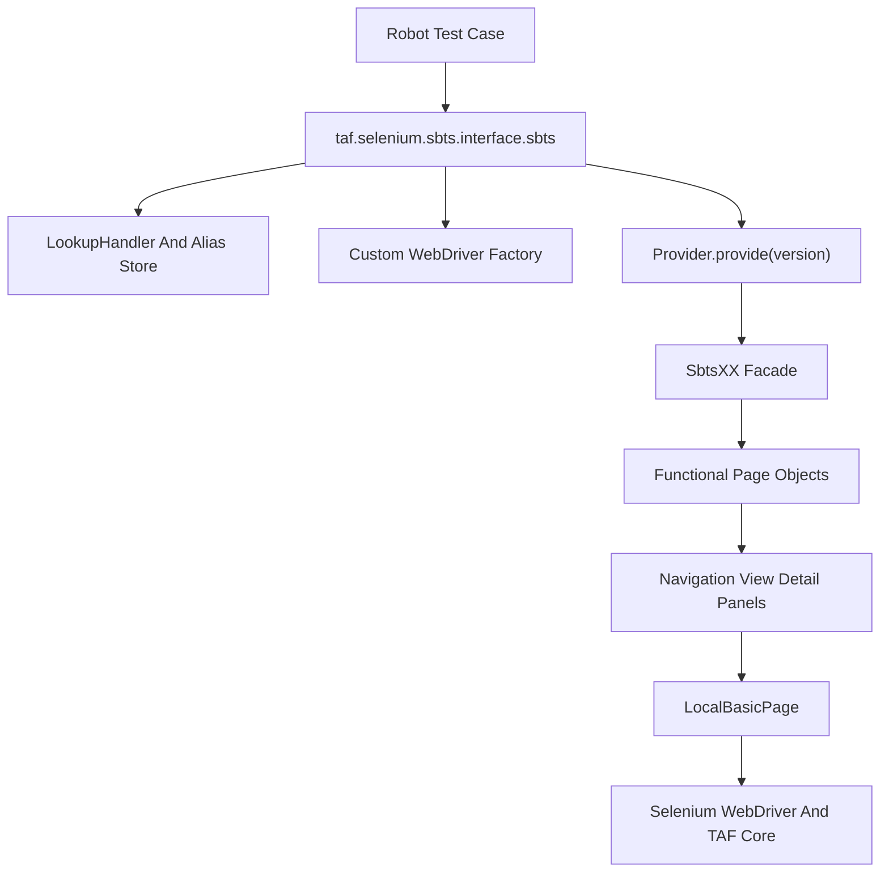
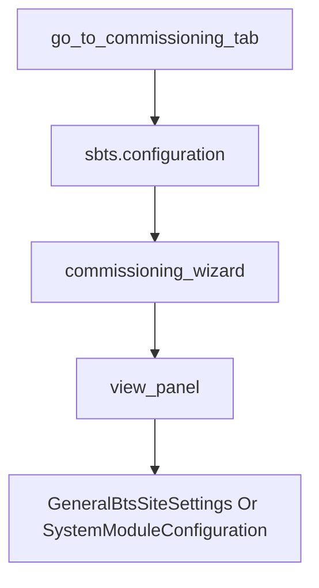

# Selenium SBTS TAF 库代码结构与实现方案分析

## 1. 分析范围

本文分析本地 TAF 库路径：

`C:\TA\site-packages\taf\selenium\sbts`

该库是面向 SBTS / WebEM Web UI 的 Selenium 自动化封装，对外以 `taf.selenium.sbts` Robot Framework library 的形式提供关键字，对内采用 `interface -> provider -> facade -> page object -> common selenium helper` 的分层结构。

本次分析基于本地源码静态阅读，并通过 TAF 文档 MCP 检索确认：`taf.selenium.sbts` 对外主要作为 Robot keyword library 使用，典型入口包括 `login`、`logout`、页面操作类关键字、诊断/配置/软件/状态查询等。

## 2. 总体结论

`taf.selenium.sbts` 是一个典型的 Page Object Model Selenium TAF 库。它把测试脚本直接调用的 Robot keyword 和底层页面细节隔离开来：

- Robot 用例只调用 `sbts.login`、`sbts.get_bts_status`、`sbts.load_ims2`、`sbts.go_to_commissioning_tab` 等业务关键字。
- `interface.py` 负责关键字入口、alias 管理、webdriver 创建、download/screenshot 目录、异常包装。
- `Provider` 根据 SBTS release 版本选择对应 facade 类，例如 `SBTS26R3` 对应 `Sbts26R3`。
- `facade.py` 组合各功能域页面对象，例如 `configuration`、`diagnostic`、`software`、`bts_status`、`performance`。
- `pages` 目录下的页面对象负责 Selenium locator、菜单导航、表单输入、弹窗处理、文件上传下载、详情面板读取等具体 UI 操作。
- 不同 SBTS 版本通过继承和局部覆盖实现兼容，新版本通常只覆盖变化页面，未变化能力继续复用上一版本。

## 3. 目录结构

核心目录和文件职责如下：

| 路径 | 主要职责 |
| --- | --- |
| `taf/selenium/sbts/__init__.py` | 暴露 `sbts` 类，使 Robot Framework 可以通过 `Library    taf.selenium.sbts` 导入 |
| `taf/selenium/sbts/interface.py` | Robot keyword 入口层，提供登录、登出、配置、诊断、状态查询等大量关键字 |
| `taf/selenium/sbts/commissioning_interface.py` | Commissioning Wizard 相关关键字入口，作为 `sbts` interface 的父类能力 |
| `taf/selenium/sbts/provider.py` | 根据传入版本字符串选择具体 `SbtsXX` facade 类 |
| `taf/selenium/sbts/facade.py` | 聚合各功能域 page object，并通过版本继承覆盖差异页面 |
| `taf/selenium/sbts/common/` | 通用 Selenium 能力、异常、下载检查、调试截图、重试装饰器 |
| `taf/selenium/sbts/pages/` | 通用 page object、登录页、菜单、弹窗、配置、诊断、状态、软件等页面实现 |
| `taf/selenium/sbts/pages/panels/` | 通用页面区域抽象，如导航面板、视图面板、详情面板 |
| `taf/selenium/sbts/pages/v20b` 到 `v26r3` | 不同 SBTS release 的差异化页面实现 |

## 4. 核心调用链

简化调用链如下：



以 `sbts.login` 为例，执行过程可以拆成以下步骤：

1. Robot 用例导入 `taf.selenium.sbts` 并调用 `sbts.login`。
2. `interface.sbts.login()` 调用 `_precheck()`，检查 Linux 下 Xvfb、geckodriver、firefox、pip list 等运行环境信息。
3. `_configure_before_login()` 设置 download 目录、screenshot 目录，并创建 `DownloadChecker`。
4. `_create_driver()` 根据参数决定复用传入的 Selenium `WebDriver`、从 Robot 变量 alias 中取 webdriver，或新建 `CustomWebDriverChrome` / `CustomWebDriverFirefox`。
5. `Provider.provide(version)` 将 `SBTS26R3` 等版本转换为 `Sbts26R3` 这类 facade 类。
6. facade 初始化时组合对应版本的功能域页面对象。
7. facade 的 `login()` 再实例化具体 `SbtsLoginPage`，打开 URL、输入用户名密码、配置 port/SSL/readonly、点击登录按钮，并处理登录后弹窗。
8. 登录成功后，`interface.py` 将 facade 实例放入 alias store，后续关键字通过 `sbts=None` 默认 alias 或指定 alias 找到同一个浏览器会话。

## 5. Robot Keyword 入口层

`interface.py` 是这个库的最外层入口，也是文件规模最大的模块。其主要职责不是直接写复杂页面逻辑，而是把 Robot keyword 请求转发到 facade 或 page object。

典型职责包括：

- 提供 Robot Framework library 类 `sbts`，并设置 `ROBOT_LIBRARY_SCOPE = 'TEST SUITE'`。
- 通过 `LookupHandler("sbts", Sbts)` 和 `@lookup_handler.implicit_lookup` 支持多 SBTS 实例 alias。
- 通过 `@catch_interface_exception` 统一捕获 keyword 执行异常并截图、记录调试信息。
- 通过 `@catch_intercepted_click_exception` 等装饰器处理点击遮挡类 Selenium 问题。
- 管理 download 目录和 screenshot 目录。
- 创建或复用 Firefox / Chrome WebDriver。
- 对外暴露大量业务关键字，如登录、登出、页面刷新、BTS 信息读取、配置管理、诊断操作、软件管理、commissioning 操作等。

示例调用形态：

```robotframework
*** Settings ***
Library    taf.selenium.sbts    WITH NAME    sbts

*** Test Cases ***
Login To SBTS
    sbts.login    ${WEBUI_URL}    ${WEBUI_NAME}    ${WEBUI_PWD}    version=SBTS26R3    browser=Firefox
```

这个入口层的好处是 Robot 用例不需要知道底层页面类、XPath、弹窗处理和版本差异，只需要调用相对稳定的业务关键字。

## 6. Provider 与版本选择

`provider.py` 的核心是 `Provider.provide(version)`：

- 默认版本是 `sbts26r3`。
- 如果调用方不传版本或传空字符串，则使用默认版本。
- 如果传入 `SBTS26R3`、`26R3`、`sbts26r3` 这类字符串，会通过正则抽取版本部分并转换为 `sbts26r3`。
- 再从 `SupportedSbts` 中查找同名类，找不到时回退到默认版本。

这说明该库把版本选择集中在一个地方，避免业务关键字里到处判断版本。

简化逻辑如下：

```python
version="SBTS26R3" -> "26r3" -> "sbts26r3" -> SupportedSbts.sbts26r3 -> Sbts26R3
```

## 7. Facade 聚合层

`facade.py` 是页面对象的聚合层。基础类 `Sbts` 在初始化时创建多个功能域对象：

- `lab_access_login`
- `debug`
- `user_account_management_for_admin`
- `bts_basic_info`
- `bts_status`
- `configuration`
- `performance`
- `alarms`
- `software`
- `web_element_manager_reload_modal`
- `plug_and_play_modal`
- `diagnostic`
- `procedures`
- `rnd_mode`
- `options`
- `browser`

每个属性背后都是一个功能域 page object 或功能域聚合对象。这样 `interface.py` 里的 keyword 可以通过类似下面的方式调用：

```python
sbts.configuration.commissioning_wizard.view_panel.set_bts_name(bts_name)
sbts.bts_basic_info.load_ims2(file_path, int(timeout))
sbts.logout(int(click_timeout), int(timeout))
```

这种 facade 设计把“一个登录会话下可以操作的所有页面能力”聚合成一个对象，便于 alias store 管理，也便于不同版本覆盖差异。

## 8. 版本继承与增量覆盖

`facade.py` 中从 `Sbts20B` 到 `Sbts26R3` 形成一条版本继承链。每个版本类只覆盖该版本变化的功能域：

- `Sbts20B` 覆盖 `software`、`diagnostic`、`rnd_mode`。
- `Sbts22R2` 覆盖 `rnd_mode`、`diagnostic`、`configuration`、`bts_status`、`software`。
- `Sbts23R1` 覆盖 `bts_status`、`diagnostic`、`bts_basic_info`、`procedures`、`configuration`。
- `Sbts25R1` 引入 `security`，并切换到新版菜单机制。
- `Sbts26R1` 覆盖 `configuration`、`software`、`bts_status`、`diagnostic`、`bts_basic_info`、`rnd_mode`。
- `Sbts26R2` 覆盖 `configuration`、`diagnostic`、`procedures`。
- `Sbts26R3` 主要覆盖登录页实现，其他能力继承 `Sbts26R2`。

例如 `pages/v26r3` 目录只有 `login_management.py` 和 `__init__.py`，说明 `26R3` 的 UI 差异集中在登录行为上，其余页面沿用 `26R2` 或更早版本实现。

这种实现方案适合产品 UI 随 release 演进但整体功能域稳定的场景。新增版本时可以先继承上一版本，只在发生变化的页面目录中新增或覆盖类。

## 9. Page Object 层

`pages` 目录是 Selenium 实现的主体，整体上分为两类：

1. 通用页面对象：如 `login_management.py`、`menu.py`、`modals.py`、`configuration/`、`diagnostic.py`、`software.py`、`bts_status.py` 等。
2. 版本化页面对象：如 `v20b/`、`v21a/`、`v22r2/`、`v25r1/`、`v26r2/`、`v26r3/` 等。

页面对象的常见模式是：

- 页面类继承 `NavigatablePage`，提供 `_get_route_list()` 描述菜单路径。
- 页面类内部组合 `NavigationPanel`、`ViewPanel`、`DetailPanel`。
- ViewPanel 负责主要表单、按钮、表格、树结构、文件上传下载等操作。
- DetailPanel 负责右侧详情面板的信息提取。
- NavigationPanel 用于封装某些页面内导航动作。
- 页面类中集中定义 XPath / CSS locator 常量，方法中调用 `LocalBasicPage` 提供的基础 Selenium 操作。

例如配置管理相关模块里有：

- `configuration/configuration.py`：聚合 configuration 下的子页面。
- `configuration/configuration_management/parameter_editor.py`：参数编辑页面。
- `configuration/configuration_management/commissioning_wizard/commissioning_wizard.py`：commissioning wizard 页面。
- `configuration/certificate_management.py`：证书管理相关页面。
- `configuration/ncf_configuration.py`：NCF 参数和错误页面。

## 10. 页面导航机制

页面导航由 `NavigatablePage` 和 `Menu` 配合完成。

`NavigatablePage` 定义统一方法：

- 子类实现 `_get_route_list()`，返回菜单路径列表。
- `navigate_to()` 调用 `Menu.open_page(route_list)`。

`Menu.open_page()` 的主要逻辑：

- 根据菜单路径拼接主菜单、子菜单、目标 tab 的 XPath。
- 如果当前页面已经 active，则直接返回。
- 通过 hover、click、scrollIntoView 等方式逐级打开菜单。
- 对 Configuration Management 这类容易弹窗的菜单，会检查并关闭 validation errors、radio configuration warning 等弹窗。

这套设计把“如何从左侧/顶部菜单进入页面”的逻辑从具体业务方法中抽离出来，页面方法只负责进入页面后的操作。

## 11. 通用 Selenium 封装

`common/common.py` 中的 `LocalBasicPage` 是本库最重要的基础类之一。它继承自 `taf.selenium.core.common.PagePart`，在 TAF Selenium Core 的基础上补充了 SBTS Web UI 特有操作：

- download checker / downloader 访问。
- screenshot 保存。
- 隐藏通知消息框。
- 等待元素可点击、等待元素不可见。
- 将元素 scroll into view。
- 操作隐藏文件上传按钮。
- 读取 XPath 元素属性。
- 处理多选下拉框和 checkbox。
- 通过 JavaScript 暂时显示或隐藏 SBTS 页面元素。

`common/utils.py` 提供：

- `choose_selector_way`：把 CSS selector 或 id 转成 JavaScript selector 表达式。
- `wait_for_operation_success`：简单重试装饰器。
- `mark_deprecated`：记录函数废弃告警。
- `check_if_selenium_required_process_exist`：打印 Xvfb、geckodriver、firefox、pip list 信息。

`common/debug.py` 提供 interface 层异常保护，例如在 keyword 出错时截图、记录浏览器和 Python 版本、检查 Selenium 相关进程。

`common/exceptions.py` 定义业务异常，例如：

- `ParamNotEditable`
- `ParamDoesNotExist`
- `ButtonCanNotClick`
- `FailedLoginException`
- `VersionNotSupport`
- `ObjectNotFoundException`

这些异常让上层 keyword 能以业务语义暴露失败原因，而不是只抛原始 Selenium exception。

## 12. 登录与弹窗处理

登录逻辑主要位于 `pages/login_management.py` 以及版本化登录页中，例如 `pages/v26r3/login_management.py`。

基础登录流程包括：

1. `driver.get(url)` 打开 WebEM / SBTS 页面。
2. 输入 username、password。
3. 展开 Options，配置 port、SSL。
4. 根据参数设置 readonly checkbox。
5. 点击 Login。
6. 检查 Session establishment error 弹窗，如有则返回错误信息。
7. 根据 `modal_action_configurations` 处理 Additional hardware detected 等弹窗。
8. 处理 BTS Start-up View、Legal Notice、Downgraded Privileges、Web Element Manager Reload 等弹窗。
9. 登录异常时通过 `Debug(...).save_screenshot('login')` 截图并关闭浏览器。

版本化登录页通常只覆盖发生变化的方法。例如 `v26r3.SbtsLoginPage` 继承 `v26r1.SbtsLoginPage`，只调整 `_configure_port_and_ssl()`，在 SSL checkbox 不存在时跳过选择。

## 13. 文件下载与截图

下载和截图由 interface 层和 common 层共同完成：

- `interface.py` 的 `_set_download_dir()` 决定下载目录，如果未传入则创建临时目录。
- `_set_default_screenshot_dir()` 在下载目录下创建默认截图目录 `taf_selenium_sbts_screenshot`。
- `_create_download_checker()` 创建 `DownloadChecker`。
- `common/download.py` 中 `DownloadChecker` 封装 `taf.selenium.core.download_tools.Downloader`，用于等待和检查下载文件。
- `LocalBasicPage.save_screenshot()` 在指定目录保存带时间戳的 PNG 文件。

这种设计让每个 SBTS 会话都有对应的下载和调试产物目录，方便失败排查。

## 14. Commissioning Wizard 扩展

`commissioning_interface.py` 把 commissioning wizard 相关关键字从主 interface 中拆出，`interface.sbts` 通过继承 `SbtsCommissioning` 获得这些能力。

典型调用链如下：



例如 `set_bts_name` keyword 会要求当前已经进入 `General BTS/Site Settings` tab，然后调用：

```python
sbts.configuration.commissioning_wizard.view_panel.set_bts_name(bts_name)
```

这种设计把 commissioning wizard 中的具体 tab 和字段配置下沉到 `commissioning_wizard_settings` 子目录中，避免主入口层继续膨胀。

## 15. 实现优点

这个库的主要优点：

- 对 Robot 用例屏蔽了 Selenium 细节，keyword 更接近测试业务语言。
- `Provider + Facade` 让版本选择集中化，便于支持多个 SBTS release。
- 高版本通过继承低版本实现增量覆盖，减少重复代码。
- Page Object 分层较清楚，页面、面板、通用操作之间职责基本明确。
- 登录后弹窗、菜单弹窗、下载、截图、环境检查等横切能力都有统一封装。
- 支持 alias store，可以在同一个 Robot suite 中维护多个 SBTS 浏览器会话。
- 失败时自动截图和记录环境信息，对 UI 自动化排障有价值。

## 16. 维护风险

需要关注的风险和技术债：

- `interface.py` 文件非常长，关键字数量多，后续维护时容易出现入口层膨胀。
- XPath / CSS locator 大量散布在页面类中，当前没有统一 locator registry，UI 改版时需要逐页面排查。
- 代码中仍有较多旧 Selenium API 用法，例如 `find_element_by_xpath`、`switch_to_window`，在较新 Selenium 版本中可能需要迁移。
- 部分等待逻辑依赖 `time.sleep`、自定义 retry 和隐式状态判断，复杂 UI 场景下可能产生 flaky。
- 版本继承链较长，如果某一中间版本覆盖行为不清晰，后续版本可能继承到非预期逻辑。
- 弹窗处理逻辑分散在登录、菜单、具体页面中，新增弹窗时需要确认触发位置。
- provider 找不到版本时回退默认版本，这对兼容性友好，但也可能掩盖版本参数拼写错误。
- 多 alias、多浏览器、多下载目录并行使用时，需要注意目录隔离和资源回收。

## 17. 后续维护建议

新增 SBTS 版本时建议：

1. 先在 `provider.py` 的 `SupportedSbts` 中增加新版本 facade 类。
2. 在 `facade.py` 中让新版本继承上一版本 facade。
3. 只在 `pages/vXX/` 下新增发生变化的页面类。
4. 未变化页面继续复用上一版本，避免复制整套页面。
5. 如果菜单结构变化，需要重点检查 `Menu`、`NavigatablePage._get_route_list()` 和 `_switch_to_new_menu()` 相关逻辑。

新增 Robot keyword 时建议：

1. 优先确认功能应该属于哪个 facade 功能域，例如 `configuration`、`diagnostic`、`software`。
2. 具体 Selenium 操作放在 page object 或 panel 类中。
3. `interface.py` 只做参数转换、alias lookup、异常包装和调用转发。
4. 页面方法中尽量复用 `LocalBasicPage` 已有等待、点击、输入、下载、截图能力。
5. 对版本差异明显的功能，优先通过版本化 page object 覆盖，而不是在 keyword 入口中写大量版本判断。

治理技术债时建议：

- 逐步把旧 Selenium API 迁移为 `find_element(By.XPATH, ...)`、`driver.switch_to.window(...)` 等新写法。
- 对高频失败 locator 建立集中说明，记录对应页面、业务含义和版本影响范围。
- 对 `interface.py` 可按功能域拆分 mixin 或子 interface，降低单文件维护成本。
- 对 provider 的未知版本回退行为增加日志或显式告警，避免误用默认版本。
- 对常见弹窗建立统一处理策略，减少页面方法各自处理。
- 对复杂页面操作补充小粒度文档或示例 Robot case，方便测试人员正确调用。

## 18. 适合理解源码的阅读顺序

如果后续继续深入这个库，建议按以下顺序阅读：

1. `__init__.py`：确认 Robot library 暴露入口。
2. `interface.py`：确认关键字名称、参数和 alias 机制。
3. `provider.py`：理解版本如何映射到 facade。
4. `facade.py`：理解每个版本组合了哪些功能域页面对象。
5. `pages/login_management.py`：理解基础登录和弹窗处理。
6. `pages/menu.py`、`pages/navigatable_page.py`：理解页面导航机制。
7. `common/common.py`：理解通用 Selenium 操作能力。
8. 目标功能域页面，例如 `pages/configuration/`、`pages/diagnostic.py` 或对应 `pages/v26r2/` 差异页面。

## 19. 一句话总结

`taf.selenium.sbts` 的核心设计是：用 Robot keyword 提供稳定业务入口，用 provider/facade 选择和聚合不同 SBTS 版本的页面对象，用 Page Object 和 panel 抽象封装 Selenium UI 操作，并通过继承覆盖方式支撑多 release Web UI 的长期演进。
