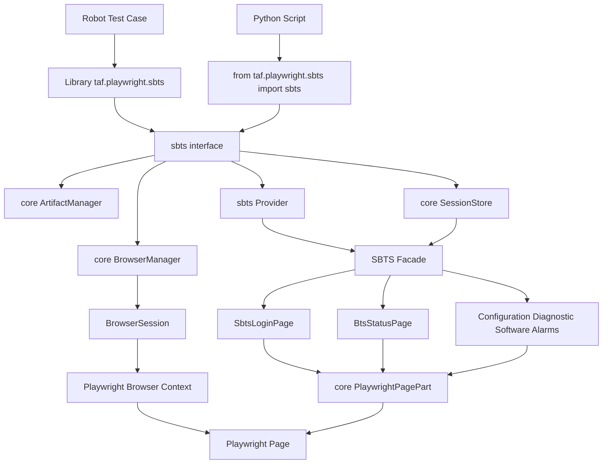
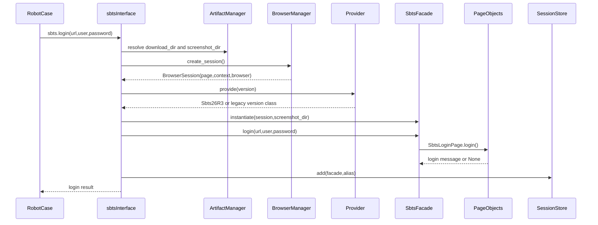
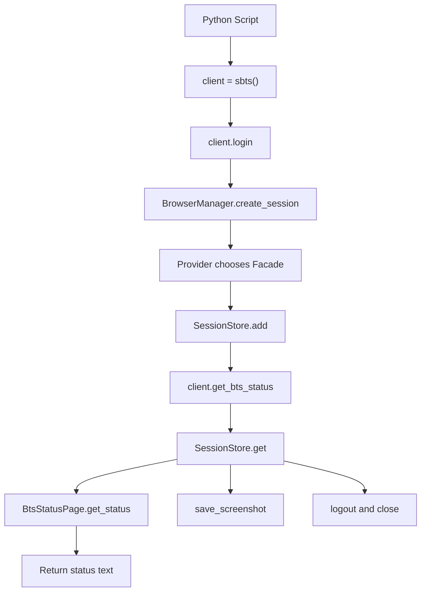
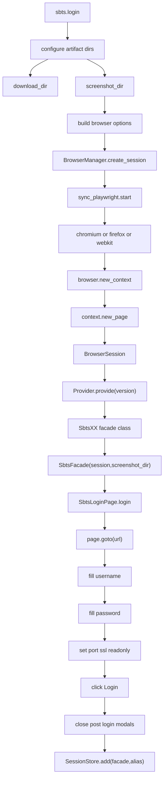
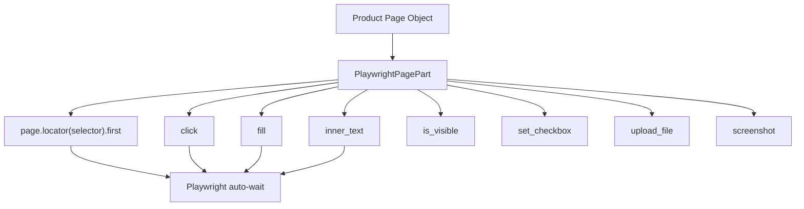
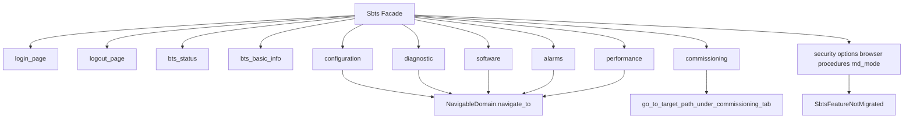
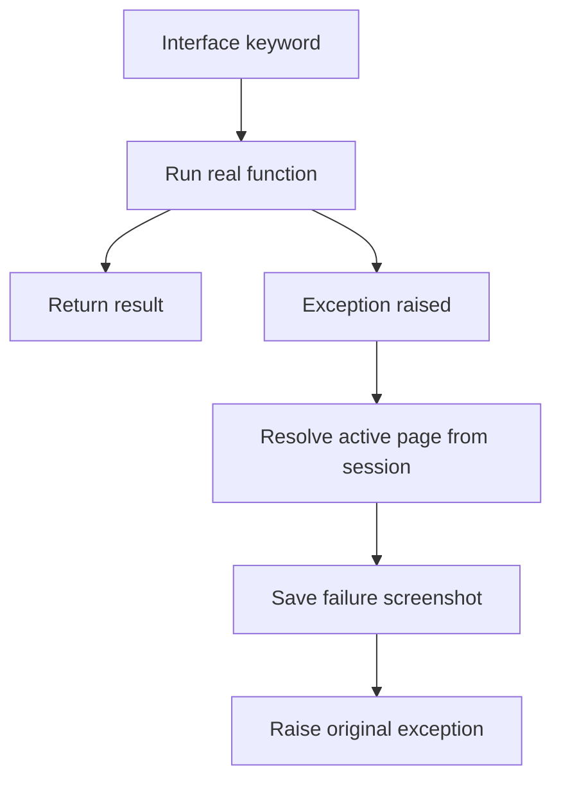
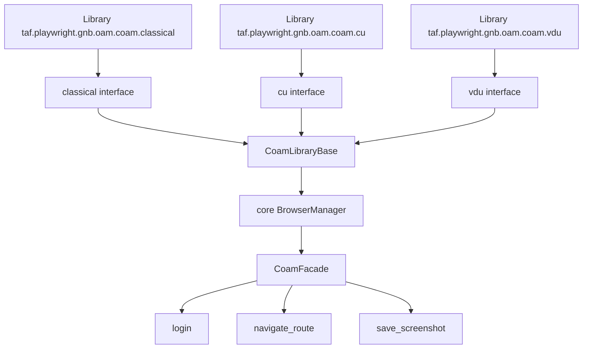
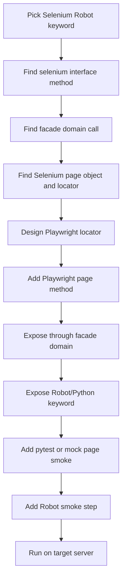

# TAF Playwright 库方案代码实现流程图

## 1. 文档目的

本文说明当前 `C:\TA\site-packages\taf\playwright` 这套 Playwright TAF 库的代码实现流程，包括：

- Robot Framework 如何调用 `taf.playwright.sbts`
- Python 如何直接调用 `taf.playwright.sbts`
- `taf.playwright.core` 公共内核如何支撑 SBTS / COAM 等产品库
- 登录、页面操作、截图、登出、异常截图的核心调用链
- 后续从 Selenium 迁移更多业务 keyword 时应该落在哪一层

当前实现原则：

- `taf.selenium` 保留不动，作为回退基线。
- `taf.playwright` 是新命名空间，Robot 用例显式切换到 `Library    taf.playwright...`。
- Playwright 库本质是普通 Python class，可以脱离 Robot Framework 直接用 Python 调用。

## 2. 总体分层架构



对应核心文件：

| 层级 | 文件 |
| --- | --- |
| Robot / Python 入口 | `C:\TA\site-packages\taf\playwright\sbts\interface.py` |
| 公共浏览器生命周期 | `C:\TA\site-packages\taf\playwright\core\browser.py` |
| 公共页面操作基类 | `C:\TA\site-packages\taf\playwright\core\common.py` |
| 公共 artifact 管理 | `C:\TA\site-packages\taf\playwright\core\artifacts.py` |
| 公共 session 管理 | `C:\TA\site-packages\taf\playwright\core\session.py` |
| SBTS 版本选择 | `C:\TA\site-packages\taf\playwright\sbts\provider.py` |
| SBTS facade | `C:\TA\site-packages\taf\playwright\sbts\facade.py` |
| SBTS 登录页面 | `C:\TA\site-packages\taf\playwright\sbts\pages\login_management.py` |
| SBTS 状态页面 | `C:\TA\site-packages\taf\playwright\sbts\pages\bts_status.py` |
| COAM 共享骨架 | `C:\TA\site-packages\taf\playwright\gnb\oam\coam\common.py` |

## 3. Robot Framework 调用流程

Robot 用例写法：

```robotframework
*** Settings ***
Library    taf.playwright.sbts    WITH NAME    sbts

*** Test Cases ***
Smoke
    sbts.login    ${URL}    ${USER}    ${PASSWORD}
    ${status}=    sbts.get_bts_status
    sbts.save_screenshot    smoke
    sbts.logout
```

调用流程如下：



关键点：

- Robot 不直接操作 Playwright `page`。
- Robot 只调用 `interface.py` 中暴露的 public methods。
- `SessionStore` 保存当前 SBTS facade，后续 `get_bts_status`、`save_screenshot`、`logout` 都从 alias 找回同一个浏览器会话。

## 4. Python 直接调用流程

Playwright TAF 库可以不依赖 Robot Framework，直接作为普通 Python 包使用。

```python
import sys
sys.path.insert(0, r"C:\TA\site-packages")

from taf.playwright.sbts import sbts

client = sbts()

try:
    client.login(
        url="https://your-sbts-host",
        username="Nemuadmin",
        password="nemuuser",
        version="SBTS26R3",
        browser="chromium",
        headless=True,
        screenshot_dir=r"C:\TA\taf_doc\python_smoke_screenshots",
        trace_dir=r"C:\TA\taf_doc\python_smoke_trace",
    )

    print(client.get_bts_status())
    client.go_to_configuration()
    client.save_screenshot("python_smoke")
    client.logout()
finally:
    client.close_all()
```

Python 直调流程：



这种方式适合：

- 快速调试 locator
- 快速验证 login/status/screenshot
- 在不启动 Robot Framework 的情况下做开发 smoke
- 后续接入 pytest 单元测试或集成测试

## 5. 登录实现内部流程

`sbts.login()` 是当前最关键的入口，它负责：

1. 准备下载目录和截图目录
2. 创建 Playwright browser/context/page
3. 按 SBTS 版本选择 facade
4. 调用登录页面对象
5. 保存 session alias



## 6. Page Object 操作流程

当前 Playwright 页面对象不直接散落使用 Playwright API，而是复用 `PlaywrightPagePart`。



和 Selenium 方案相比：

| Selenium 实现 | Playwright 实现 |
| --- | --- |
| `WebDriverWait` + expected conditions | Locator 自带 auto-wait |
| `driver.find_element_by_xpath` | `page.locator(selector)` |
| `driver.get(url)` | `page.goto(url)` |
| `element.click()` 可能被遮挡 | Locator click 自动等待可点击状态 |
| 手工管理下载轮询 | `page.expect_download()` + 文件轮询 |
| 手工 browser/window 切换 | Browser context / page 事件 |

## 7. Facade 和业务域流程

SBTS facade 是一个浏览器会话的业务聚合对象。



当前业务域状态：

| 域 | 状态 |
| --- | --- |
| `login` / `logout` | 已有可运行 Playwright 实现 |
| `bts_status` | 已有基础实现，真实 selector 需目标环境校准 |
| `configuration` | 第一版导航模板 |
| `commissioning` | 第一版 Commissioning Wizard 路径导航模板 |
| `diagnostic` | 第一版导航模板 |
| `software` | 第一版导航模板 |
| `alarms` | 第一版导航模板 |
| `performance` | 第一版导航模板 |
| `security` / `options` / `browser` / `procedures` / `rnd_mode` | facade 已占位，未迁移 keyword 会明确报错 |

## 8. 异常截图流程

Robot 或 Python 调用的关键入口使用 `catch_interface_exception` 装饰器。



好处：

- keyword 失败时尽量自动保存当前页面截图。
- 不吞异常，仍然把真实错误抛给 Robot / Python。
- 后续可以扩展为 Robot log 自动嵌图、trace zip 链接、console log 收集。

## 9. COAM 迁移模板流程

`gnb.oam.coam.classical`、`cu`、`vdu` 目前使用同一套 `CoamLibraryBase` 和 `CoamFacade` 骨架。



这部分目前是 smoke 骨架，后续要按真实 COAM 页面结构扩展：

- provider / version map
- facade domain composition
- configuration / diagnostic / software / alarms 等 page objects
- classical / cu / vdu 差异化 locators

## 10. 后续迁移开发流程

新增一个 Selenium keyword 的 Playwright 迁移时，建议按以下顺序做：



落点规则：

| 要做的事 | 推荐落点 |
| --- | --- |
| 通用 browser/context/page 管理 | `taf.playwright.core.browser` |
| 通用页面操作 | `taf.playwright.core.common` |
| 通用下载 | `taf.playwright.core.download` |
| 通用截图/异常捕获 | `taf.playwright.core.debug` |
| 产品版本选择 | 产品自己的 `provider.py` |
| 业务域聚合 | 产品自己的 `facade.py` |
| 具体页面操作 | 产品自己的 `pages/` |
| Robot / Python 对外入口 | 产品自己的 `interface.py` |

## 11. 验证入口

Python 快速验证：

```powershell
$env:PYTHONPATH="C:\TA\site-packages;$env:PYTHONPATH"
python your_smoke.py
```

pytest 验证：

```powershell
python -m pytest C:\TA\site-packages\taf\playwright\tests -q
```

Robot SBTS smoke：

```powershell
$env:SBTS_URL="https://<target-sbts-host>"
$env:SBTS_USERNAME="<username>"
$env:SBTS_PASSWORD="<password>"
robot C:\TA\taf_doc\playwright_sbts_smoke.robot
```

Robot COAM smoke：

```powershell
$env:COAM_URL="https://<target-coam-host>"
$env:COAM_USERNAME="<username>"
$env:COAM_PASSWORD="<password>"
robot C:\TA\taf_doc\playwright_coam_classical_smoke.robot
```

预期结果：

- Python/pytest 层验证公共内核和 provider/session 基本能力。
- Robot smoke 验证真实浏览器、真实登录页、真实菜单路径和截图 artifact。
- 如果真实 UI selector 不匹配，应优先更新产品 `pages/` 或 domain route，而不是改 `core`。
